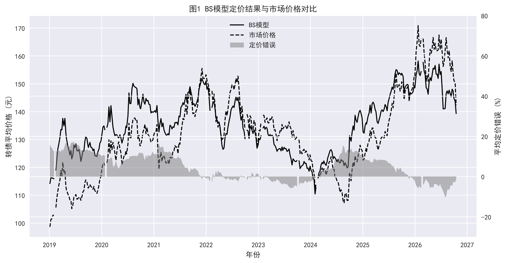
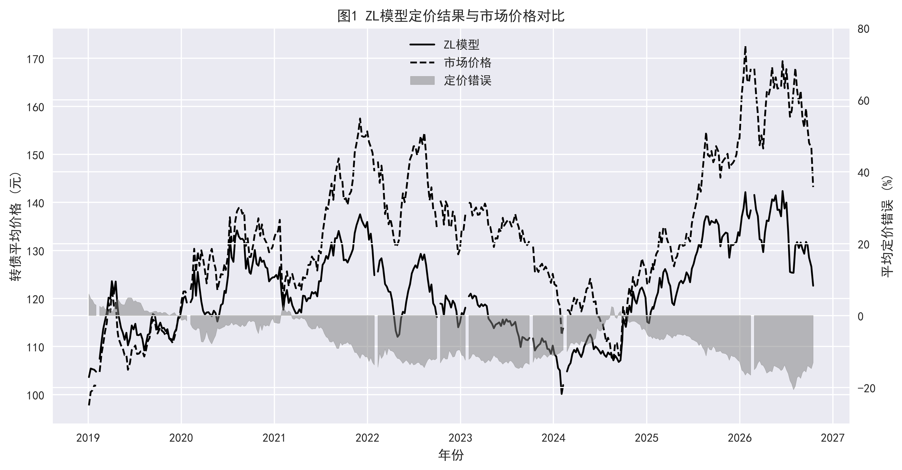
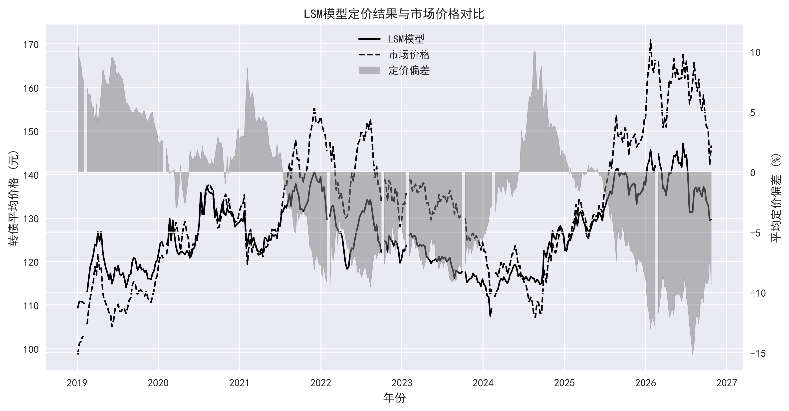
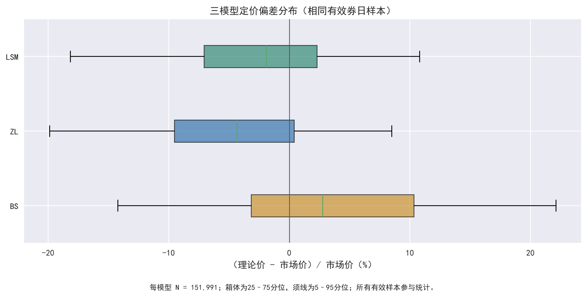
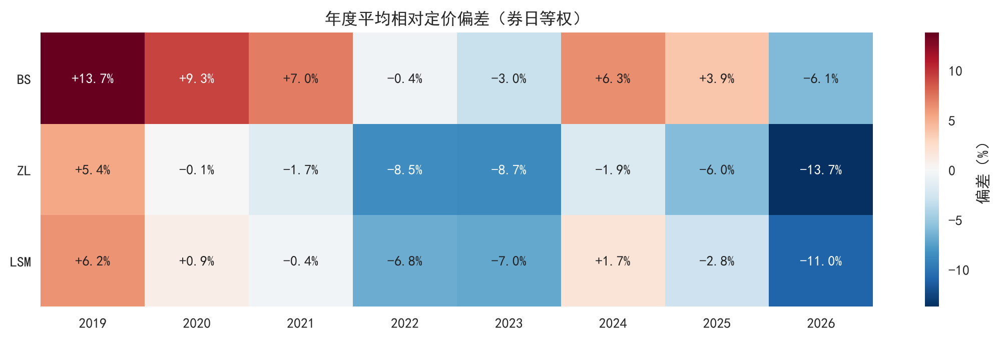
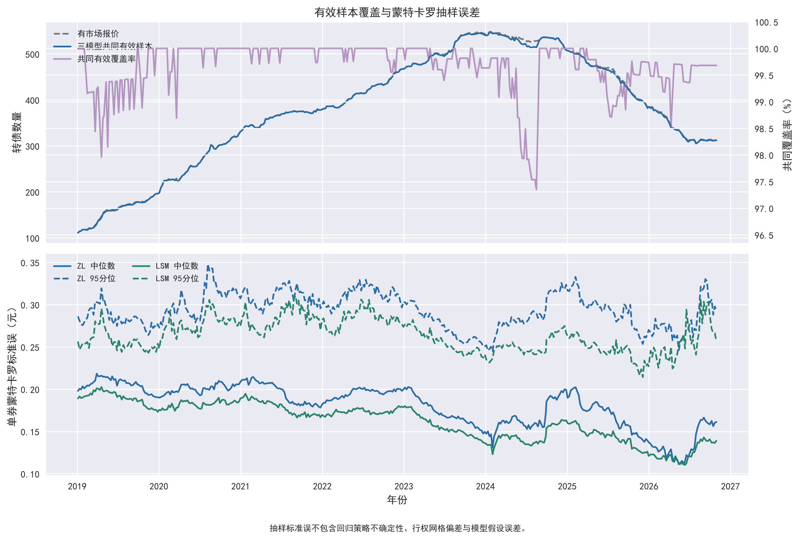

# 中国市场可转债定价模型研究 | Convertible Bond Pricing Research

<p align="center">
  <a href="#简体中文"></a>
  &nbsp;
  <a href="#english-version"></a>
</p>

<p align="center">
  
  
  
  
</p>

<p align="center">
  <a href="summary/key_findings.md"></a>
  <a href="long-short%20strategy/weekly_value_results_pricing_v2_2026/README.md"></a>
  <a href="report/README.md"></a>
</p>

---

<a id="简体中文"></a>

## 简体中文

[English](#english-version)

## 项目概述

本项目比较中国可转债的 Black-Scholes（BS）、条款停止蒙特卡洛（ZL）和最小二乘蒙特卡洛（LSM）定价，并分别检验定价偏差、因子预测能力和组合表现。定价更贴近市场报价，并不直接意味着策略收益更高。

## 定价方法

文献中的 CCB 在给定不赎回保护期下进行解析定价。本项目已完成独立的[CCB 2023实验](experiments/ccb_2023/README.md)，使用实际利率曲线并纳入可核实的不赎回承诺；CCBA的发行人行为概率加权尚未实施。

三个模型独立读取真实观测输入，统一使用合同票息、到期支付、转股日期和条款终止规则。现金支付考虑信用折现，转股支付使用国债利率代理。缺失或不一致输入保留排除原因。

- **BS** 使用真实转股到期日和剩余合同现金价值计算欧式转股基准，不显式处理发行人赎回与持有人回售。
- **ZL** 模拟真实条款计数、转股边界与存续现金流。触发后赎回及 30 个模拟交易观察日的通知期是明确的政策假设；不编造未来下修或未核实的不赎回承诺。
- **LSM** 通过继续价值回归加入自愿提前转股与回售选择，使用 8,192 条训练路径和另 8,192 条独立估值路径、对偶抽样及 192 个基础行权区间，并加入合同边界。不读取 ZL 价格，也不使用 ZL 估值下限。

### 独立CCB 2023实验（2026-10-29）

覆盖2019-01-04至2026-10-23。最新公告复核后，共有700份明确期限公告；原194份待核文件中，7份补出期限、3份确认为信息性文件、2份关联更新版，182份仍不猜填。恢复284个券日，CCB与已有BS/ZL/LSM的共同样本增至**148,704个券日、974只债券、400周**。

该共同样本上，加入明确承诺的CCB **MAE为11.3459元、RMSE为30.8193元**。18项公告测试通过，112个网格加密样本最大差异0.0068元，低于0.05元数值容差。原共同样本的价格保持不变，本次改善的是覆盖范围。见[同样本比较报告](experiments/ccb_2023/results_waivers_2023/REPORT.md)和[逐项公告复核](experiments/ccb_2023/results_waivers_2023/REVIEW_20261029.md)。CCB保留在独立研究目录，未接入生产策略；下方三模型生产指标仍使用各自原定样本。

<!-- pricing-metrics-zh:start -->
## 定价结果

三个模型使用相同的 **151,991 个有效券日、400 个观察周**。MSE 单位为元²，RMSE、MAE 和平均偏差为元，MAPE 为绝对百分比偏差。平均偏差为理论价减市场价，R²相对于市场报价均值计算。最低单周共同覆盖率 **97.35%**，最新周 **312/313** 只。指标衡量模型与市场报价的偏离。

| 模型 | 样本数 | MSE | RMSE | MAE | MAPE | 平均偏差 | R² |
|---|---:|---:|---:|---:|---:|---:|---:|
| BS | 151,991 | 975.31 | 31.23 | 13.58 | 9.28% | +1.45 | 0.816 |
| ZL | 151,991 | 999.37 | 31.61 | 12.36 | 7.92% | -9.38 | 0.812 |
| LSM | 151,991 | 970.92 | 31.16 | 11.31 | 7.14% | -6.80 | 0.817 |
<!-- pricing-metrics-zh:end -->

[指标数据](backtest/Pricing_Metrics.csv) · [验证记录](backtest/Pricing_Validation.json)

## 因子与预测检验

每个模型的定价偏差与五个观测因子共同检验：流动性、波动率、量价相关性、估值和动量。估值反向后，各因子统一为数值越高代表预设有利方向。Pearson 与 Spearman 相关用于检查冗余；IC 与 Rank IC 使用同一模型内共同合格截面和下一持有期个券收益。ICIR 为均值除以样本标准差，不年化。

| 模型 | 因子 | 持有期数 | IC | Rank IC | ICIR | Rank ICIR | IC 为正比例 |
|---|---|---|---|---|---|---|---|
| BS | 定价偏差 | 93 | 0.084 | 0.047 | 0.51 | 0.28 | 66.7% |
| BS | 流动性 | 93 | -0.030 | -0.076 | -0.13 | -0.41 | 46.2% |
| BS | 动量 | 93 | 0.018 | -0.008 | 0.09 | -0.05 | 60.2% |
| BS | 量价相关性 | 93 | -0.006 | -0.061 | -0.04 | -0.39 | 46.2% |
| BS | 估值 | 93 | 0.054 | 0.059 | 0.27 | 0.34 | 62.4% |
| BS | 波动率 | 93 | -0.024 | -0.077 | -0.09 | -0.29 | 45.2% |
| ZL | 流动性 | 93 | -0.030 | -0.076 | -0.13 | -0.41 | 46.2% |
| ZL | 动量 | 93 | 0.018 | -0.008 | 0.09 | -0.05 | 60.2% |
| ZL | 量价相关性 | 93 | -0.006 | -0.061 | -0.04 | -0.39 | 46.2% |
| ZL | 估值 | 93 | 0.054 | 0.059 | 0.27 | 0.34 | 62.4% |
| ZL | 波动率 | 93 | -0.024 | -0.077 | -0.09 | -0.29 | 45.2% |
| ZL | 定价偏差 | 93 | 0.099 | 0.089 | 0.51 | 0.53 | 74.2% |
| LSM | 流动性 | 93 | -0.030 | -0.076 | -0.13 | -0.41 | 46.2% |
| LSM | 定价偏差 | 93 | 0.100 | 0.108 | 0.47 | 0.58 | 76.3% |
| LSM | 动量 | 93 | 0.018 | -0.008 | 0.09 | -0.05 | 60.2% |
| LSM | 量价相关性 | 93 | -0.006 | -0.061 | -0.04 | -0.39 | 46.2% |
| LSM | 估值 | 93 | 0.054 | 0.059 | 0.27 | 0.34 | 62.4% |
| LSM | 波动率 | 93 | -0.024 | -0.077 | -0.09 | -0.29 | 45.2% |

## 组合规则与结果

周度均价策略使用三模型理论价的算术平均，在风险合格池中最多选取前 20%，要求扣除往返成本后的估值余量至少为 2%。单边综合摩擦 5bp，单券最多 10%，未使用资金保留现金；下一交易日开盘重新检查冻结估值给出的买入上限。每日核算实际模拟成交、费用、按年化 3% 假设计提的借券成本，以及有记录的陈旧或无法解释估值。

| 组合 | 年化研究收益 | 夏普 | 最大回撤 |
|---|---|---|---|
| long_only | 16.83% | 1.27 | -16.45% |
| long_short | 13.21% | 1.36 | -11.91% |

净值是观测价格与已核验现金流的研究估计。历史付息、原始财务版本和券源仍未全部核验，因此不能称为完整总收益或事前实盘记录。事后重算信号不会覆盖原有交易前冻结证据。

月度六因子组合对标准化因子等权合成并持有排名前 20%，使用每个月最后一个已观察定价截面，包含当前未完结月份的可用端点；端点随周更新时整体重算派生历史。实现按每次新入选持仓比例扣除 6bp 换仓成本；年化超额为组合与基准年化收益之差。

| 模型 | 年化超额收益 | 夏普 | 最大回撤 |
|---|---|---|---|
| BS | 11.69% | 0.8 | -29.72% |
| ZL | 10.51% | 0.77 | -27.59% |
| LSM | 10.63% | 0.78 | -28.24% |

## 关键图表

### 策略与转债 ETF 净值对比


多头、理论多空、中证转债指数与 511380.SH 按各自首个观测值归一化为 1。保留策略完整区间，ETF 使用真实收盘价与同日复权因子，上市前留空，作大致走势参考。

### 定价偏差与抽样不确定性













### 月度因子多头组合


### 因子相关性与 IC


## 更新与复现

每次周更新依次执行行情输入、三模型独立定价、观测因子、IC、策略核算、年度逐周报告、图表和 README，任一步失败即停止发布。周报在暂存目录生成并校验后，与其他结果一起提交和推送，新增周报也纳入提交。定价只追加已验证边界之后的交易周，因子与组合结果按同一套定价输入重新计算。输入指纹和产物 Manifest 会识别相同截止日下的数据或定价变更，替换前的结果由 Git 保留。

```powershell
python backtest/rebuild_research_outputs.py --full-history --refresh-inputs --promote
```

该研究入口读取已有定价、刷新策略输入并重算研究结果。常规周更新在本地运行 `backtest/weekly_update.bat`，包括前置数据和定价更新、周报生成及推送 GitHub。GitHub Actions 已取消定时触发，仅保留手动备用入口。

通过 `backtest/setup_weekly_task.ps1` 注册 Windows 本地任务：每周五北京时间 17:15，使用已验证的 Python 环境。电脑需开机、联网且用户已登录；错过时间后在条件满足时补跑。校验失败停止发布，自动提交仅包含周更新产物，保留无关的本地修改。

## 局限性

市场报价偏差不等于相对已知公允价值的误差。发行人行为、股息、信用处理、模拟网格与回归策略仍有模型假设。蒙特卡洛标准误只反映给定策略下的抽样误差，不覆盖训练策略和模型假设的不确定性。相关性和定价拟合不能单独证明可交易的 Alpha。

## 参考资料

- [郑振龙、林海（2004）— 中国可转换债券定价研究，厦门大学学报（哲学社会科学版）第2期，93–99页](report/中国可转换债券定价研究.pdf)
- [中国可转债定价模型比较研究](report/A%20Comparison%20of%20Chinese%20Convertible%20Bond%20Pricing%20Models.pdf)
- [Northeast Securities — Convertible Bond Research Framework](report/Northeast_Securities_Convertible_Bond_Research_Framework_Theory_to_Strategy_20240823.pdf)
- [Guosheng Securities — Pricing Models and Applications](report/Guosheng_Securities_Convertible_Bond_Pricing_Models_and_Applications_20230302.pdf)
- [Zheshang Securities — Pricing Panorama](report/Zheshang_Securities_Convertible_Bond_Pricing_Panorama_Models_Algorithms_and_Applications_20231201.pdf)
- [Guosheng Securities — Redemption Probability Adjusted Pricing](report/Guosheng_Securities_Convertible_Bond_Redemption_Probability_Adjusted_Pricing_Model_20240208.pdf)
- [Zheshang Securities — Option Pricing, Factor Enhancement and Clause Games](report/Zheshang_Securities_Convertible_Bond_Quantitative_Investing_Option_Pricing_Factor_Enhancement_and_Clause_Games_20250918.pdf)

---

<a id="english-version"></a>

## English Version

[简体中文](#简体中文)

## Overview

This project compares Black-Scholes (BS), clause-stopping Monte Carlo (ZL), and Least-Squares Monte Carlo (LSM) for Chinese convertible bonds. Pricing deviations, factor predictiveness and investable portfolio behaviour are evaluated separately.

## Pricing methods

In the referenced research, CCB provides analytical pricing for a specified call-protection period. The independent [CCB 2023 experiment](experiments/ccb_2023/README.md) now uses observed yield curves and verified non-call commitments. CCBA's issuer-behaviour probability weighting has not been implemented.

All models read observed inputs independently. Contractual coupons, maturity payments, conversion dates and termination rules use the same conventions. Cash payments receive credit discounting; share conversion uses the government-rate proxy. Missing or inconsistent inputs remain excluded with recorded reasons.

- **BS** values European conversion with actual conversion expiry and contractual cash value. Issuer call and holder put options are outside this baseline.
- **ZL** simulates observed clause counters, conversion boundaries and cash flows. Calling after a qualifying trigger with a 30-observation notice period is a disclosed policy assumption. Future discretionary resets and unverified waivers are not invented.
- **LSM** adds voluntary early conversion and optional puts using continuation regression. It uses 8,192 training paths and another 8,192 independent valuation paths, antithetic sampling and 192 base exercise intervals with contractual boundaries. It does not read ZL prices or impose a ZL floor.

### Independent CCB 2023 experiment (2026-10-29)

The experiment covers 2019-01-04 through 2026-10-23 and now includes 700 notices with explicit protection periods. Reviewing the previous 194-item queue resolved seven periods, classified three informational notices and linked two superseded drafts to their replacements; 182 periods remain unfilled. This restores 284 bond-date observations and expands the common sample with saved BS/ZL/LSM prices to **148,704 observations, 974 bonds and 400 weeks**.

On that common sample, CCB with explicit commitments has **MAE 11.3459 yuan and RMSE 30.8193 yuan**. All 18 announcement tests pass; 112 refined-grid checks have a maximum difference of 0.0068 yuan, below the 0.05-yuan numerical tolerance. Prices on the previous common sample are unchanged: this review increases coverage. See the [comparison report](experiments/ccb_2023/results_waivers_2023/REPORT.md) and [notice audit](experiments/ccb_2023/results_waivers_2023/REVIEW_20261029.md). CCB remains independent of production strategies; the three-model production metrics below retain their original sample.

<!-- pricing-metrics-en:start -->
## Pricing results

All models use the same **151,991 valid bond-date cells over 400 observed weeks**. MSE is in yuan²; RMSE, MAE and bias are in yuan. Bias is model minus market price; R² uses the market-price mean as its constant baseline. Minimum weekly common coverage is **97.35%**, with **312/313** bonds in the latest week. These are market-price deviation diagnostics.

| Model | N | MSE | RMSE | MAE | MAPE | Bias | R² |
|---|---:|---:|---:|---:|---:|---:|---:|
| BS | 151,991 | 975.31 | 31.23 | 13.58 | 9.28% | +1.45 | 0.816 |
| ZL | 151,991 | 999.37 | 31.61 | 12.36 | 7.92% | -9.38 | 0.812 |
| LSM | 151,991 | 970.92 | 31.16 | 11.31 | 7.14% | -6.80 | 0.817 |
<!-- pricing-metrics-en:end -->

[Pricing metrics](backtest/Pricing_Metrics.csv) · [Validation evidence](backtest/Pricing_Validation.json)

## Factors and predictive tests

Five observed factors accompany each model's valuation gap: liquidity, volatility, price-volume correlation, valuation and momentum. Valuation is reversed so higher direction-adjusted values consistently represent the proposed favourable direction. Pearson and Spearman correlations measure redundancy. IC and Rank IC use the following holding period's individual-bond returns on the same eligible cross-section within each model. ICIR is mean divided by sample standard deviation and is not annualized.

| Model | Factor | Periods | IC | Rank IC | ICIR | Rank ICIR | Positive IC |
|---|---|---|---|---|---|---|---|
| BS | Mispricing | 93 | 0.084 | 0.047 | 0.51 | 0.28 | 66.7% |
| BS | Liquidity | 93 | -0.030 | -0.076 | -0.13 | -0.41 | 46.2% |
| BS | Momentum | 93 | 0.018 | -0.008 | 0.09 | -0.05 | 60.2% |
| BS | Price-volume | 93 | -0.006 | -0.061 | -0.04 | -0.39 | 46.2% |
| BS | Valuation | 93 | 0.054 | 0.059 | 0.27 | 0.34 | 62.4% |
| BS | Volatility | 93 | -0.024 | -0.077 | -0.09 | -0.29 | 45.2% |
| ZL | Liquidity | 93 | -0.030 | -0.076 | -0.13 | -0.41 | 46.2% |
| ZL | Momentum | 93 | 0.018 | -0.008 | 0.09 | -0.05 | 60.2% |
| ZL | Price-volume | 93 | -0.006 | -0.061 | -0.04 | -0.39 | 46.2% |
| ZL | Valuation | 93 | 0.054 | 0.059 | 0.27 | 0.34 | 62.4% |
| ZL | Volatility | 93 | -0.024 | -0.077 | -0.09 | -0.29 | 45.2% |
| ZL | Mispricing | 93 | 0.099 | 0.089 | 0.51 | 0.53 | 74.2% |
| LSM | Liquidity | 93 | -0.030 | -0.076 | -0.13 | -0.41 | 46.2% |
| LSM | Mispricing | 93 | 0.100 | 0.108 | 0.47 | 0.58 | 76.3% |
| LSM | Momentum | 93 | 0.018 | -0.008 | 0.09 | -0.05 | 60.2% |
| LSM | Price-volume | 93 | -0.006 | -0.061 | -0.04 | -0.39 | 46.2% |
| LSM | Valuation | 93 | 0.054 | 0.059 | 0.27 | 0.34 | 62.4% |
| LSM | Volatility | 93 | -0.024 | -0.077 | -0.09 | -0.29 | 45.2% |

## Portfolio rules and results

The weekly value strategy averages the three model prices, selects at most the highest eligible quintile and requires a 2% valuation margin after round-trip friction. One-way friction is 5bp; each long is capped at 10%, with unused capital in cash. Frozen valuation limits are checked again at the next session's open. Daily accounting includes observed executions, transaction costs, a 3% annual short-borrow assumption and explicitly recorded stale or unexplained marks.

| Portfolio | Annualized research return | Sharpe | Max drawdown |
|---|---|---|---|
| long_only | 16.83% | 1.27 | -16.45% |
| long_short | 13.21% | 1.36 | -11.91% |

These are research estimates from observed prices and verified cash flows. Complete historical coupons, original financial vintages and short availability remain unverified, so the curves are not certified total returns or prospective live records. Original frozen tracking evidence is never replaced by a retrospectively recalculated signal.

The monthly six-factor portfolios rank equal-weight standardized factors and hold the top quintile. They use each month's last observed pricing snapshot, including the available partial-month endpoint; the whole derived history is recalculated as that endpoint advances. The implementation charges 6bp times the fraction of newly selected names at each rebalance. Excess return is strategy annualized return minus the benchmark annualized return.

| Model | Annualized excess return | Sharpe | Max drawdown |
|---|---|---|---|
| BS | 11.69% | 0.8 | -29.72% |
| ZL | 10.51% | 0.77 | -27.59% |
| LSM | 10.63% | 0.78 | -28.24% |

## Key figures

### Strategy NAV and convertible-bond ETF


Long-only, theoretical long-short, 000832.CSI and 511380.SH each start at 1 on their own first observation. Full strategy history is retained; ETF dates before listing stay empty. The ETF uses observed closes times same-day adjustment factors. With different inception points, the chart provides a broad trend comparison.

### Pricing deviations and uncertainty


### Monthly factor portfolios


### Factor correlation and IC


## Updates and reproducibility

Every weekly update runs market inputs, independent BS/ZL/LSM pricing, observed factors, IC, strategy accounting, annual weekly reports, figures and this README before publication. Annual reports are generated and checked in staging, then committed and pushed together, including newly created weeks. Any failed stage stops publication. Pricing appends only verified new weeks; factor and portfolio outputs are recalculated against the same pricing baseline. Input fingerprints and artifact manifests detect changed data and model prices even when the cutoff is unchanged. Git preserves replaced results.

```powershell
python backtest/rebuild_research_outputs.py --full-history --refresh-inputs --promote
```

This research entrypoint uses saved pricing outputs, refreshes strategy inputs and recalculates research. Routine weekly updates run locally with `backtest/weekly_update.bat`, including the preceding data and pricing stages, weekly reports and GitHub publication. GitHub Actions has no scheduled trigger; its manual entrypoint is retained as an optional fallback.

Register the local Windows task with `backtest/setup_weekly_task.ps1`: Fridays at 17:15 Beijing time, using a validated Python environment. The computer must be on, online and the user logged in; missed starts are retried when available. Validation failures stop publication. Only generated weekly outputs are committed, preserving unrelated local changes.

## Limitations

Market deviations are not errors against known fair value. Issuer behaviour, dividends, credit treatment, simulation grids and regression policy remain model assumptions. Monte Carlo standard errors measure sampling uncertainty conditional on the fitted policy; they exclude policy-training and model uncertainty. Factor correlation and pricing fit alone do not establish tradable alpha.

## References

- [郑振龙、林海（2004）— 中国可转换债券定价研究，厦门大学学报（哲学社会科学版）第2期，93–99页](report/中国可转换债券定价研究.pdf)
- [中国可转债定价模型比较研究](report/A%20Comparison%20of%20Chinese%20Convertible%20Bond%20Pricing%20Models.pdf)
- [Northeast Securities — Convertible Bond Research Framework](report/Northeast_Securities_Convertible_Bond_Research_Framework_Theory_to_Strategy_20240823.pdf)
- [Guosheng Securities — Pricing Models and Applications](report/Guosheng_Securities_Convertible_Bond_Pricing_Models_and_Applications_20230302.pdf)
- [Zheshang Securities — Pricing Panorama](report/Zheshang_Securities_Convertible_Bond_Pricing_Panorama_Models_Algorithms_and_Applications_20231201.pdf)
- [Guosheng Securities — Redemption Probability Adjusted Pricing](report/Guosheng_Securities_Convertible_Bond_Redemption_Probability_Adjusted_Pricing_Model_20240208.pdf)
- [Zheshang Securities — Option Pricing, Factor Enhancement and Clause Games](report/Zheshang_Securities_Convertible_Bond_Quantitative_Investing_Option_Pricing_Factor_Enhancement_and_Clause_Games_20250918.pdf)
