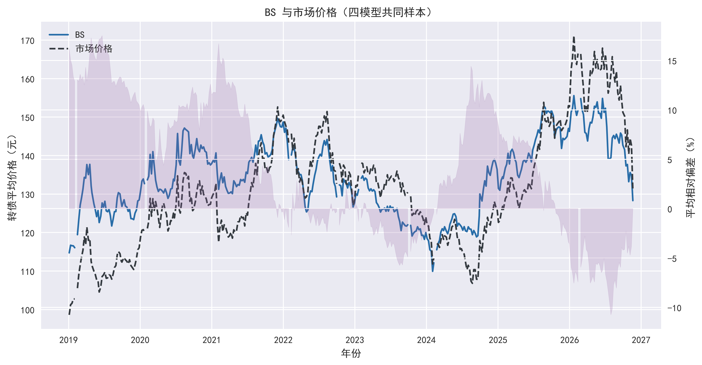
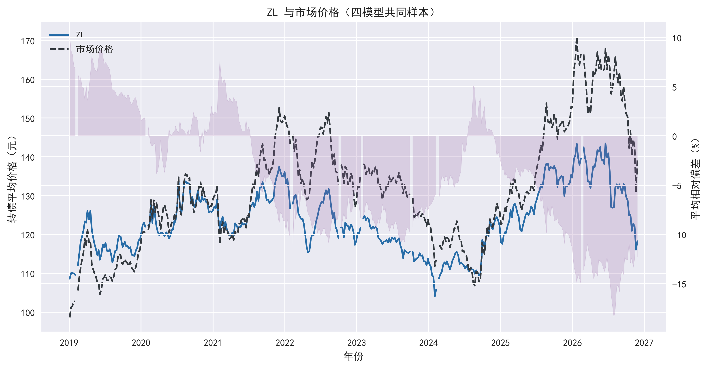
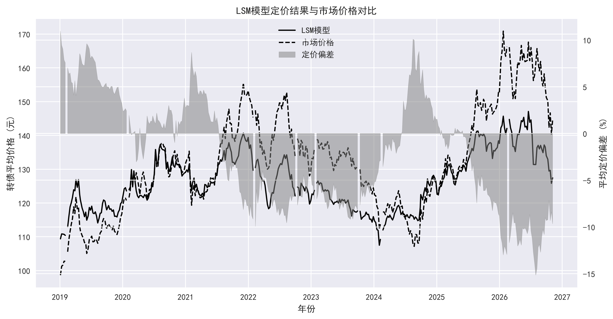
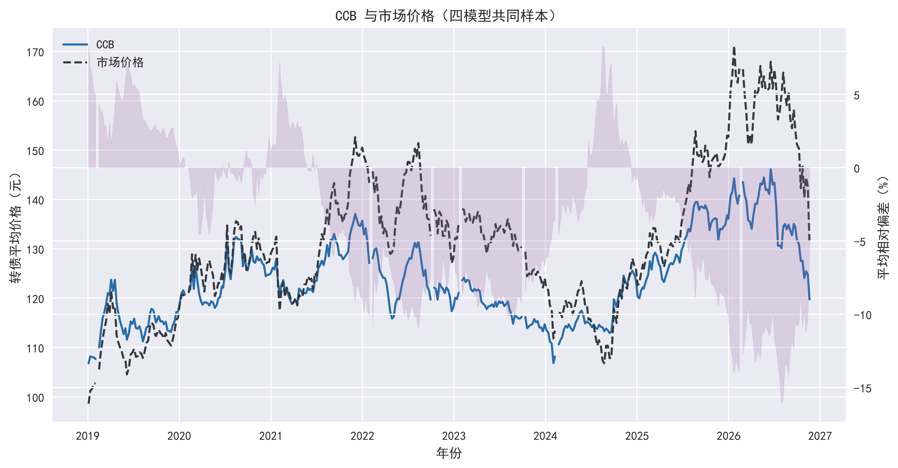
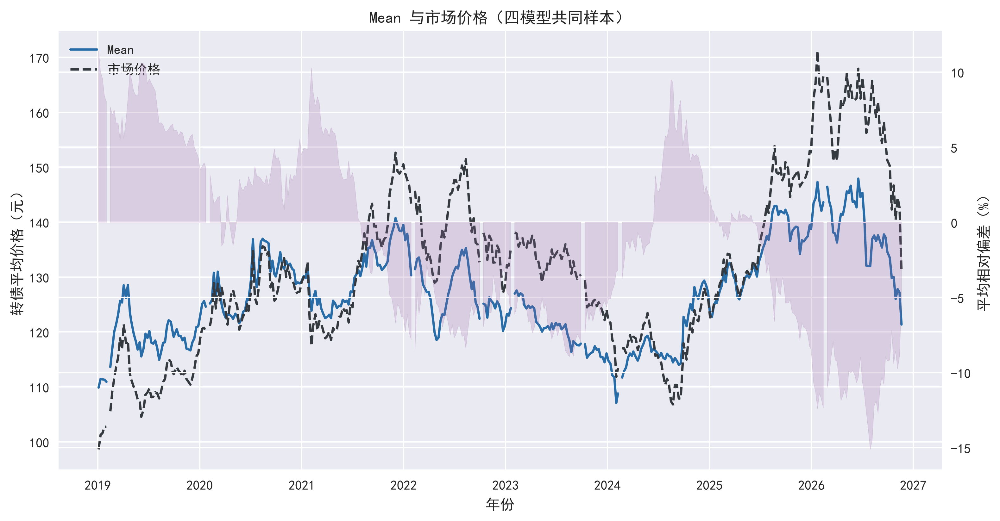
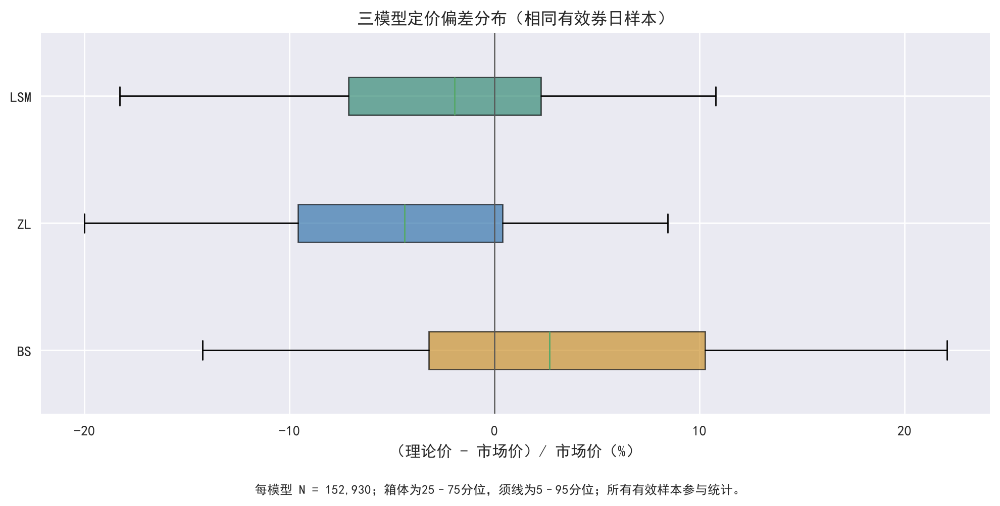
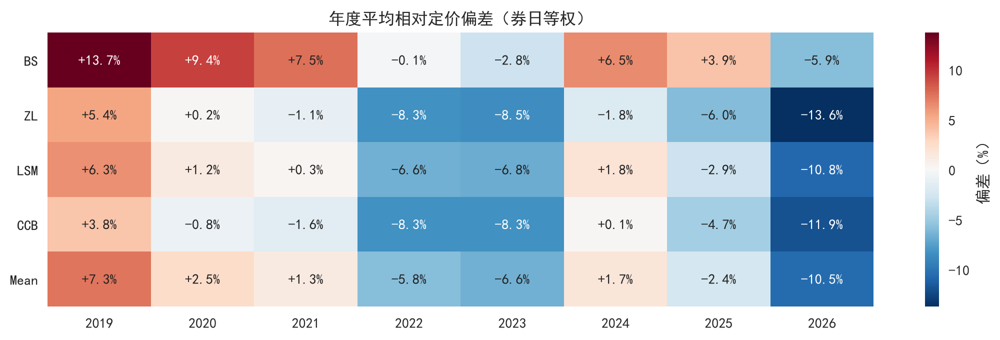
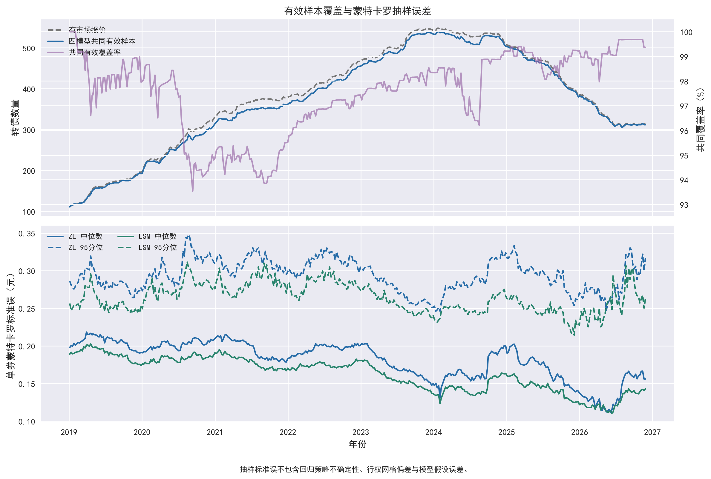

# 中国市场可转债定价模型研究 | Convertible Bond Pricing Research

<p align="center">
  <a href="#简体中文"></a>
  &nbsp;
  <a href="#english-version"></a>
</p>

<p align="center">
  
  
  
  
</p>

<p align="center">
  <a href="summary/key_findings.md"></a>
  <a href="long-short%20strategy/weekly_value_results_pricing_four_2026/README.md"></a>
  <a href="report/README.md"></a>
</p>

---

<a id="简体中文"></a>

## 简体中文

[English](#english-version)

## 项目概述

本项目使用 Black-Scholes（BS）、条款停止蒙特卡洛（ZL）、最小二乘蒙特卡洛（LSM）和含不赎回保护期的 CCB 为中国可转债定价。四模型算术平均是因子检验和组合研究的主要估值信号。

## 定价方法

四个模型各自读取估值日观测到的转股价值、正股波动率和国债利率，以及合同票息、到期兑付金额和转股起止日。信用利差用合同现金流与观测债底校准。现金支付按国债利率代理加信用利差折现，转股取得的股票按国债利率代理折现。波动率采用最多 250 个、至少 60 个复权收盘价估算。缺失或不一致的输入按债券和估值日记录。

### Black–Scholes（BS）

BS 给出欧式转股的解析估值。模型在风险中性对数正态假设下计算转股价值到实际最后转股日的分布。持有人在这一天比较转股所得和继续持有剩余合同现金流的价值，后续到期兑付款先折现到该决策日。最后转股日之前的票息单独折现。

转股价值和正股波动率是期权部分的主要驱动。模型只在最后转股日评估转股选择，省略发行人提前赎回和持有人回售，用于观察权益敞口对转债估值的影响。行权门槛取自合同现金流，已计入到期兑付款的末期票息只算一次。

### 条款停止蒙特卡洛（ZL）

ZL 在风险中性假设下模拟 10,000 条转股价值路径，并用估值日前已观测到的条款计数初始化。进入转股期后，模型在合同滚动窗口内累计达到赎回阈值的观察日。价格触发型回售则按合同规定的适用期间和连续低于回售阈值的天数判断。

估值假定发行人在达到触发条件后赎回，设置 30 个模拟交易观察日的通知期，并假定持有人在满足条件时回售。模型保留实际最后转股日的选择权，合约终止后停止计入后续票息。这个价格反映给定条款和行权规则下的现金流价值，未来酌情下修和未核实的不赎回承诺未纳入该规则。

### 最小二乘蒙特卡洛（LSM）

LSM 在合同路径规则下评估持有人何时主动转股、行使已满足条件的回售权，或继续持有。模型从到期向前回溯，用转股价值及其平方、赎回和回售计数、赎回通知剩余时间回归未来折现现金流，再将估计的继续持有价值与各项可行的即时行权价值比较。

生产设定以 8,192 条对偶训练路径拟合行权规则，再用另 8,192 条独立估值路径计算价格。192 个基础行权区间之外还加入合同边界和票息观测点。估值由拟合的行权规则和本券现金流得出。报告中的蒙特卡洛标准误衡量给定行权规则后的抽样不确定性。

### 含不赎回保护期的可转债模型（CCB）

CCB 先确定保护期，取距转股开始日的剩余期限和一个月下限中的较大值。估值日收盘时已经公开、能够确定有效期限的不赎回承诺，可以延长保护期。只有日期或在盘后发布的公告从下一交易日纳入，最新公告期限仍待核实时，该券日的 CCB 估值留空。

保护期结束后，以合同赎回价格阈值作为连续监控的障碍。平价触碰阈值时停止后续现金流并转股。模型使用真实国债期限曲线、合同现金流和观察债底，通过有限差分求解价值，周更对新增样本做网格加密检查。估值沿用 2023 版 CCB 的经济设定，省略持有人回售和未来酌情下修。

### 四模型均价

BS、ZL、LSM、CCB 各占 25%。同一券日需有四个正且有限的估值，并与同一市场报价对齐，才能计算均价。共同回测从 2019 年首个四模型周度截面起算。

[定价方法与数值验证](backtest/PRICING_METHODS.md)

<!-- pricing-metrics-zh:start -->
## 定价结果

同样本比较覆盖 **150,005 个有效券日、404 个观察周**，均价为四个模型价格的算术平均。MSE 单位为元²，RMSE、MAE 和平均偏差为元，MAPE 为绝对百分比偏差。平均偏差为理论价减市场价，R²相对于市场报价均值计算。最低单周共同覆盖率 **93.54%**，最新周 **312/314** 只。指标衡量模型与市场报价的偏离。

| 模型 | 样本数 | MSE | RMSE | MAE | MAPE | 平均偏差 | R² |
|---|---:|---:|---:|---:|---:|---:|---:|
| BS | 150,005 | 935.68 | 30.59 | 13.19 | 9.13% | +1.73 | 0.821 |
| ZL | 150,005 | 957.75 | 30.95 | 12.05 | 7.84% | -9.06 | 0.817 |
| LSM | 150,005 | 929.56 | 30.49 | 10.97 | 7.02% | -6.44 | 0.822 |
| CCB | 150,005 | 949.23 | 30.81 | 11.39 | 7.28% | -8.46 | 0.818 |
| Mean | 150,005 | 908.34 | 30.14 | 10.89 | 7.07% | -5.56 | 0.826 |
<!-- pricing-metrics-zh:end -->

[指标数据](backtest/Pricing_Metrics.csv) · [当前研究来源](backtest/Research_Migration.json) · [历史重建验证](backtest/Pricing_Validation.json)

## 因子与预测检验

每个模型的定价偏差与五个观测因子共同检验：流动性、波动率、量价相关性、估值和动量。估值反向后，各因子统一为数值越高代表预设有利方向。Pearson 与 Spearman 相关用于检查冗余；IC 与 Rank IC 使用同一模型内共同合格截面和下一持有期个券收益。ICIR 为均值除以样本标准差，不年化。

| 模型 | 因子 | 持有期数 | IC | Rank IC | ICIR | Rank ICIR | IC 为正比例 |
|---|---|---|---|---|---|---|---|
| BS | 定价偏差 | 94 | 0.085 | 0.047 | 0.52 | 0.29 | 67.0% |
| BS | 流动性 | 94 | -0.036 | -0.080 | -0.16 | -0.43 | 45.7% |
| BS | 动量 | 94 | 0.023 | -0.004 | 0.11 | -0.02 | 60.6% |
| BS | 量价相关性 | 94 | -0.009 | -0.064 | -0.06 | -0.40 | 45.7% |
| BS | 估值 | 94 | 0.057 | 0.061 | 0.28 | 0.36 | 62.8% |
| BS | 波动率 | 94 | -0.031 | -0.082 | -0.11 | -0.31 | 44.7% |
| ZL | 流动性 | 94 | -0.036 | -0.080 | -0.16 | -0.43 | 45.7% |
| ZL | 动量 | 94 | 0.023 | -0.004 | 0.11 | -0.02 | 60.6% |
| ZL | 量价相关性 | 94 | -0.009 | -0.064 | -0.06 | -0.40 | 45.7% |
| ZL | 估值 | 94 | 0.057 | 0.061 | 0.28 | 0.36 | 62.8% |
| ZL | 波动率 | 94 | -0.031 | -0.082 | -0.11 | -0.31 | 44.7% |
| ZL | 定价偏差 | 94 | 0.103 | 0.092 | 0.52 | 0.54 | 74.5% |
| LSM | 流动性 | 94 | -0.036 | -0.080 | -0.16 | -0.43 | 45.7% |
| LSM | 定价偏差 | 94 | 0.104 | 0.111 | 0.48 | 0.59 | 76.6% |
| LSM | 动量 | 94 | 0.023 | -0.004 | 0.11 | -0.02 | 60.6% |
| LSM | 量价相关性 | 94 | -0.009 | -0.064 | -0.06 | -0.40 | 45.7% |
| LSM | 估值 | 94 | 0.057 | 0.061 | 0.28 | 0.36 | 62.8% |
| LSM | 波动率 | 94 | -0.031 | -0.082 | -0.11 | -0.31 | 44.7% |
| CCB | 定价偏差 | 94 | 0.112 | 0.115 | 0.51 | 0.58 | 72.3% |
| CCB | 流动性 | 94 | -0.036 | -0.078 | -0.16 | -0.42 | 46.8% |
| CCB | 动量 | 94 | 0.030 | -0.005 | 0.14 | -0.03 | 64.9% |
| CCB | 量价相关性 | 94 | -0.010 | -0.063 | -0.06 | -0.39 | 45.7% |
| CCB | 估值 | 94 | 0.050 | 0.058 | 0.24 | 0.34 | 56.4% |
| CCB | 波动率 | 94 | -0.028 | -0.080 | -0.10 | -0.30 | 50.0% |
| Mean | 流动性 | 94 | -0.036 | -0.078 | -0.16 | -0.42 | 46.8% |
| Mean | 均价偏差 | 94 | 0.108 | 0.094 | 0.54 | 0.55 | 73.4% |
| Mean | 动量 | 94 | 0.030 | -0.005 | 0.14 | -0.03 | 64.9% |
| Mean | 量价相关性 | 94 | -0.010 | -0.063 | -0.06 | -0.39 | 45.7% |
| Mean | 估值 | 94 | 0.050 | 0.058 | 0.24 | 0.34 | 56.4% |
| Mean | 波动率 | 94 | -0.028 | -0.080 | -0.10 | -0.30 | 50.0% |

## 组合规则与结果

周度策略按四模型均价相对当日收盘价的估值余量排名，在风险合格池中最多选取前 20%，要求扣除往返成本后的估值余量至少为 2%。单边综合摩擦 5bp，单券最多 10%，未使用资金保留现金。下一交易日开盘重新检查冻结估值给出的买入上限。账户按日核算模拟成交、费用、年化 3% 的假设借券成本和有记录的陈旧估值。

组合日度核算截至 **2026-11-25**。

| 组合 | 年化研究收益 | 夏普 | 最大回撤 |
|---|---|---|---|
| long_only | 15.97% | 1.25 | -17.57% |
| long_short | 13.14% | 1.34 | -12.09% |

净值是观测价格与已核验现金流的研究估计。历史付息、原始财务版本和券源仍未全部核验，因此不能称为完整总收益或事前实盘记录。事后重算信号不会覆盖原有交易前冻结证据。

月度六因子组合对标准化因子等权合成并持有排名前 20%，使用每个月最后一个已观察定价截面，包含当前未完结月份的可用端点；端点随周更新时整体重算派生历史。实现按每次新入选持仓比例扣除 6bp 换仓成本；年化超额为组合与基准年化收益之差。

| 模型 | 年化超额收益 | 夏普 | 最大回撤 |
|---|---|---|---|
| BS | 10.48% | 0.66 | -30.11% |
| ZL | 9.74% | 0.65 | -28.66% |
| LSM | 9.86% | 0.66 | -28.26% |
| CCB | 10.72% | 0.7 | -29.05% |
| Mean | 10.52% | 0.69 | -28.69% |

## 关键图表

### 策略与转债 ETF 净值对比


多头、理论多空、中证转债指数与 511380.SH 按各自首个观测值归一化为 1。保留策略完整区间，ETF 使用真实收盘价与同日复权因子，上市前留空，作大致走势参考。

### 定价偏差与抽样不确定性

















### 月度因子多头组合


### 因子相关性与 IC


## 更新与复现

历年研究周报 [2019](long-short%20strategy/weekly_value_results_pricing_four_2019/README.md) · [2020](long-short%20strategy/weekly_value_results_pricing_four_2020/README.md) · [2021](long-short%20strategy/weekly_value_results_pricing_four_2021/README.md) · [2022](long-short%20strategy/weekly_value_results_pricing_four_2022/README.md) · [2023](long-short%20strategy/weekly_value_results_pricing_four_2023/README.md) · [2024](long-short%20strategy/weekly_value_results_pricing_four_2024/README.md) · [2025](long-short%20strategy/weekly_value_results_pricing_four_2025/README.md) · [2026](long-short%20strategy/weekly_value_results_pricing_four_2026/README.md)

每次周更新依次执行行情输入、四模型独立定价、观测因子、IC、策略核算、年度逐周报告、图表和 README。定价只追加已验证边界之后的交易周。CCB 先增量检索发行人公告，再为新增交易周估值，因子与组合研究按同一套定价结果重新计算。任一步失败即停止发布。

```powershell
python backtest/rebuild_research_outputs.py --full-history --refresh-inputs --promote
```

该研究入口读取已有定价、刷新策略输入并重算研究结果。常规周更新在本地运行 `backtest/weekly_update.bat`，包括前置数据和定价更新、周报生成及推送 GitHub。GitHub Actions 已取消定时触发，仅保留手动备用入口。

通过 `backtest/setup_weekly_task.ps1` 注册 Windows 本地任务：每周五北京时间 16:30，使用已验证的 Python 环境。电脑需开机、联网且用户已登录；错过时间后在条件满足时补跑，失败后每小时重试一次、最多12次。校验失败停止发布，自动提交仅包含周更新产物，保留无关的本地修改。

## 局限性

市场报价偏差不等于相对已知公允价值的误差。发行人行为、股息、信用处理、模拟网格与回归策略仍有模型假设。蒙特卡洛标准误只反映给定策略下的抽样误差，不覆盖训练策略和模型假设的不确定性。相关性和定价拟合不能单独证明可交易的 Alpha。

## 参考资料

- [郑振龙、林海（2004）— 中国可转换债券定价研究，厦门大学学报（哲学社会科学版）第2期，93–99页](report/中国可转换债券定价研究.pdf)
- [中国可转债定价模型比较研究](report/A%20Comparison%20of%20Chinese%20Convertible%20Bond%20Pricing%20Models.pdf)
- [Northeast Securities — Convertible Bond Research Framework](report/Northeast_Securities_Convertible_Bond_Research_Framework_Theory_to_Strategy_20240823.pdf)
- [Guosheng Securities — Pricing Models and Applications](report/Guosheng_Securities_Convertible_Bond_Pricing_Models_and_Applications_20230302.pdf)
- [Zheshang Securities — Pricing Panorama](report/Zheshang_Securities_Convertible_Bond_Pricing_Panorama_Models_Algorithms_and_Applications_20231201.pdf)
- [Guosheng Securities — Redemption Probability Adjusted Pricing](report/Guosheng_Securities_Convertible_Bond_Redemption_Probability_Adjusted_Pricing_Model_20240208.pdf)
- [Zheshang Securities — Option Pricing, Factor Enhancement and Clause Games](report/Zheshang_Securities_Convertible_Bond_Quantitative_Investing_Option_Pricing_Factor_Enhancement_and_Clause_Games_20250918.pdf)

---

<a id="english-version"></a>

## English Version

[简体中文](#简体中文)

## Overview

This project prices Chinese convertible bonds with Black-Scholes (BS), clause-stopping Monte Carlo (ZL), Least-Squares Monte Carlo (LSM) and CCB with issuer call protection. The four-model arithmetic mean is the main valuation signal for the factor and portfolio research.

## Pricing methods

All four models independently read observed conversion value, volatility and government yields, along with the bond's coupon schedule, redemption amount and conversion dates. Each calibrates a nonnegative credit spread to the observed straight-bond value using the contractual cash flows. Cash payments are discounted with that spread and the government-rate proxy. Shares received on conversion are discounted at the government-rate proxy alone. Volatility uses up to 250 adjusted stock closes, with at least 60 required. Missing or inconsistent inputs are recorded by bond and date.

### Black–Scholes (BS)

BS is the closed-form European conversion benchmark. It carries the observed conversion value to the last permitted conversion date under a risk-neutral lognormal process. On that date the holder chooses between converting into shares and retaining the remaining contractual cash flows. The model values those cash flows at the decision date, including any later redemption payment. Coupons paid before the last conversion date are discounted separately.

Conversion value and stock volatility drive the option component. The model's single exercise date and omission of issuer calls and holder puts make it a benchmark for the equity exposure of the bond. The valuation uses the actual contractual cash alternative as the exercise threshold, and the final coupon already included in the redemption amount is counted once.

### Clause-stopping Monte Carlo (ZL)

ZL simulates 10,000 risk-neutral paths for conversion value. Each path starts from the call and put counters observed on the valuation date. A call can qualify once conversion opens and the contractual rolling count reaches its threshold. A price-triggered put requires the applicable contract window and consecutive observations below the put threshold.

The issuer is assumed to call after the qualifying trigger, with a notice period of 30 simulated trading observations. The holder is assumed to take a qualifying put. The model evaluates conversion through the last permitted conversion date and stops future coupons when the contract terminates. The result is a valuation under a specified exercise policy. Future discretionary conversion-price resets and unverified non-call commitments fall outside that policy.

### Least-Squares Monte Carlo (LSM)

LSM uses the contractual path rules and estimates whether a holder should convert early, exercise an available put or continue holding. Working backward through exercise dates, it regresses future discounted cash flows on conversion value, its square, the call and put counters, and the time left in any call notice. It compares that continuation estimate with the value of each permitted immediate action.

The production model uses 8,192 antithetic training paths to fit the policy and another 8,192 independent valuation paths to price it. Its 192 base exercise intervals are supplemented with contractual boundaries and coupon observations. Each valuation comes from this fitted policy and the bond's cash flows. Reported Monte Carlo standard errors measure sampling uncertainty conditional on that policy.

### CCB with issuer call protection

CCB starts with a call-protection period based on the remaining time before conversion opens and a one-month minimum. When a dated issuer commitment to refrain from calling was public by the valuation close, the remaining commitment period can extend that protection. Date-only and after-close disclosures enter on the next trading session. A latest decision whose period remains unresolved leaves the corresponding CCB price missing.

Once protection ends, the observed contractual call threshold becomes a continuously monitored barrier. Crossing it ends the cash-flow stream and delivers shares. The model uses the observed government yield curve and contractual cash flows in a finite-difference solution, with grid refinement checks before publication. Its holder-put and future reset assumptions follow the 2023 model; the result omits both features.

### Four-model mean

The mean weights BS, ZL, LSM and CCB at 25% each. A bond-date requires four positive finite prices and an identical observed market quote. The four-model comparison and strategy history begin at the first shared weekly valuation in 2019.

[Detailed pricing methods and numerical checks](backtest/PRICING_METHODS.md)

<!-- pricing-metrics-en:start -->
## Pricing results

All models use the same **150,005 valid bond-date cells over 404 observed weeks**. MSE is in yuan²; RMSE, MAE and bias are in yuan. Bias is model minus market price; R² uses the market-price mean as its constant baseline. Minimum weekly common coverage is **93.54%**, with **312/314** bonds in the latest week. These are market-price deviation diagnostics.

| Model | N | MSE | RMSE | MAE | MAPE | Bias | R² |
|---|---:|---:|---:|---:|---:|---:|---:|
| BS | 150,005 | 935.68 | 30.59 | 13.19 | 9.13% | +1.73 | 0.821 |
| ZL | 150,005 | 957.75 | 30.95 | 12.05 | 7.84% | -9.06 | 0.817 |
| LSM | 150,005 | 929.56 | 30.49 | 10.97 | 7.02% | -6.44 | 0.822 |
| CCB | 150,005 | 949.23 | 30.81 | 11.39 | 7.28% | -8.46 | 0.818 |
| Mean | 150,005 | 908.34 | 30.14 | 10.89 | 7.07% | -5.56 | 0.826 |
<!-- pricing-metrics-en:end -->

[Pricing metrics](backtest/Pricing_Metrics.csv) · [Current research provenance](backtest/Research_Migration.json) · [Archived rebuild validation](backtest/Pricing_Validation.json)

## Factors and predictive tests

Five observed factors accompany each model's valuation gap: liquidity, volatility, price-volume correlation, valuation and momentum. Valuation is reversed so higher direction-adjusted values consistently represent the proposed favourable direction. Pearson and Spearman correlations measure redundancy. IC and Rank IC use the following holding period's individual-bond returns on the same eligible cross-section within each model. ICIR is mean divided by sample standard deviation and is not annualized.

| Model | Factor | Periods | IC | Rank IC | ICIR | Rank ICIR | Positive IC |
|---|---|---|---|---|---|---|---|
| BS | Mispricing | 94 | 0.085 | 0.047 | 0.52 | 0.29 | 67.0% |
| BS | Liquidity | 94 | -0.036 | -0.080 | -0.16 | -0.43 | 45.7% |
| BS | Momentum | 94 | 0.023 | -0.004 | 0.11 | -0.02 | 60.6% |
| BS | Price-volume | 94 | -0.009 | -0.064 | -0.06 | -0.40 | 45.7% |
| BS | Valuation | 94 | 0.057 | 0.061 | 0.28 | 0.36 | 62.8% |
| BS | Volatility | 94 | -0.031 | -0.082 | -0.11 | -0.31 | 44.7% |
| ZL | Liquidity | 94 | -0.036 | -0.080 | -0.16 | -0.43 | 45.7% |
| ZL | Momentum | 94 | 0.023 | -0.004 | 0.11 | -0.02 | 60.6% |
| ZL | Price-volume | 94 | -0.009 | -0.064 | -0.06 | -0.40 | 45.7% |
| ZL | Valuation | 94 | 0.057 | 0.061 | 0.28 | 0.36 | 62.8% |
| ZL | Volatility | 94 | -0.031 | -0.082 | -0.11 | -0.31 | 44.7% |
| ZL | Mispricing | 94 | 0.103 | 0.092 | 0.52 | 0.54 | 74.5% |
| LSM | Liquidity | 94 | -0.036 | -0.080 | -0.16 | -0.43 | 45.7% |
| LSM | Mispricing | 94 | 0.104 | 0.111 | 0.48 | 0.59 | 76.6% |
| LSM | Momentum | 94 | 0.023 | -0.004 | 0.11 | -0.02 | 60.6% |
| LSM | Price-volume | 94 | -0.009 | -0.064 | -0.06 | -0.40 | 45.7% |
| LSM | Valuation | 94 | 0.057 | 0.061 | 0.28 | 0.36 | 62.8% |
| LSM | Volatility | 94 | -0.031 | -0.082 | -0.11 | -0.31 | 44.7% |
| CCB | Mispricing | 94 | 0.112 | 0.115 | 0.51 | 0.58 | 72.3% |
| CCB | Liquidity | 94 | -0.036 | -0.078 | -0.16 | -0.42 | 46.8% |
| CCB | Momentum | 94 | 0.030 | -0.005 | 0.14 | -0.03 | 64.9% |
| CCB | Price-volume | 94 | -0.010 | -0.063 | -0.06 | -0.39 | 45.7% |
| CCB | Valuation | 94 | 0.050 | 0.058 | 0.24 | 0.34 | 56.4% |
| CCB | Volatility | 94 | -0.028 | -0.080 | -0.10 | -0.30 | 50.0% |
| Mean | Liquidity | 94 | -0.036 | -0.078 | -0.16 | -0.42 | 46.8% |
| Mean | Mean-price deviation | 94 | 0.108 | 0.094 | 0.54 | 0.55 | 73.4% |
| Mean | Momentum | 94 | 0.030 | -0.005 | 0.14 | -0.03 | 64.9% |
| Mean | Price-volume | 94 | -0.010 | -0.063 | -0.06 | -0.39 | 45.7% |
| Mean | Valuation | 94 | 0.050 | 0.058 | 0.24 | 0.34 | 56.4% |
| Mean | Volatility | 94 | -0.028 | -0.080 | -0.10 | -0.30 | 50.0% |

## Portfolio rules and results

The weekly value strategy ranks the four-model mean relative to the same-day close. It selects at most the highest eligible quintile and requires a 2% valuation margin after round-trip friction. One-way friction is 5bp. Each long is capped at 10%, with unused capital in cash. Frozen valuation limits are checked again at the next session's open. Daily accounting includes observed executions, transaction costs, a 3% annual short-borrow assumption and explicitly recorded stale or unexplained marks.

Daily portfolio accounting through **2026-11-25**.

| Portfolio | Annualized research return | Sharpe | Max drawdown |
|---|---|---|---|
| long_only | 15.97% | 1.25 | -17.57% |
| long_short | 13.14% | 1.34 | -12.09% |

These are research estimates from observed prices and verified cash flows. Complete historical coupons, original financial vintages and short availability remain unverified, so the curves are not certified total returns or prospective live records. Original frozen tracking evidence is never replaced by a retrospectively recalculated signal.

The monthly six-factor portfolios rank equal-weight standardized factors and hold the top quintile. They use each month's last observed pricing snapshot, including the available partial-month endpoint; the whole derived history is recalculated as that endpoint advances. The implementation charges 6bp times the fraction of newly selected names at each rebalance. Excess return is strategy annualized return minus the benchmark annualized return.

| Model | Annualized excess return | Sharpe | Max drawdown |
|---|---|---|---|
| BS | 10.48% | 0.66 | -30.11% |
| ZL | 9.74% | 0.65 | -28.66% |
| LSM | 9.86% | 0.66 | -28.26% |
| CCB | 10.72% | 0.7 | -29.05% |
| Mean | 10.52% | 0.69 | -28.69% |

## Key figures

### Strategy NAV and convertible-bond ETF


Long-only, theoretical long-short, 000832.CSI and 511380.SH each start at 1 on their own first observation. Full strategy history is retained; ETF dates before listing stay empty. The ETF uses observed closes times same-day adjustment factors. With different inception points, the chart provides a broad trend comparison.

### Pricing deviations and uncertainty


### Monthly factor portfolios


### Factor correlation and IC


## Updates and reproducibility

Weekly research archives [2019](long-short%20strategy/weekly_value_results_pricing_four_2019/README.md) · [2020](long-short%20strategy/weekly_value_results_pricing_four_2020/README.md) · [2021](long-short%20strategy/weekly_value_results_pricing_four_2021/README.md) · [2022](long-short%20strategy/weekly_value_results_pricing_four_2022/README.md) · [2023](long-short%20strategy/weekly_value_results_pricing_four_2023/README.md) · [2024](long-short%20strategy/weekly_value_results_pricing_four_2024/README.md) · [2025](long-short%20strategy/weekly_value_results_pricing_four_2025/README.md) · [2026](long-short%20strategy/weekly_value_results_pricing_four_2026/README.md)

Every weekly update runs market inputs, independent BS/ZL/LSM/CCB pricing, observed factors, IC, strategy accounting, annual weekly reports, figures and this README before publication. Pricing appends verified new weeks. CCB searches for new issuer notices before valuing new weeks, and factor and portfolio research are recalculated against the resulting four-model baseline. Any failed stage stops publication.

```powershell
python backtest/rebuild_research_outputs.py --full-history --refresh-inputs --promote
```

This research entrypoint uses saved pricing outputs, refreshes strategy inputs and recalculates research. Routine weekly updates run locally with `backtest/weekly_update.bat`, including the preceding data and pricing stages, weekly reports and GitHub publication. GitHub Actions has no scheduled trigger; its manual entrypoint is retained as an optional fallback.

Register the local Windows task with `backtest/setup_weekly_task.ps1`: Fridays at 16:30 Beijing time, using a validated Python environment. The computer must be on, online and the user logged in; missed starts are retried when available. Failed runs retry hourly up to 12 times. Validation failures stop publication. Only generated weekly outputs are committed, preserving unrelated local changes.

## Limitations

Market deviations are not errors against known fair value. Issuer behaviour, dividends, credit treatment, simulation grids and regression policy remain model assumptions. Monte Carlo standard errors measure sampling uncertainty conditional on the fitted policy; they exclude policy-training and model uncertainty. Factor correlation and pricing fit alone do not establish tradable alpha.

## References

- [郑振龙、林海（2004）— 中国可转换债券定价研究，厦门大学学报（哲学社会科学版）第2期，93–99页](report/中国可转换债券定价研究.pdf)
- [中国可转债定价模型比较研究](report/A%20Comparison%20of%20Chinese%20Convertible%20Bond%20Pricing%20Models.pdf)
- [Northeast Securities — Convertible Bond Research Framework](report/Northeast_Securities_Convertible_Bond_Research_Framework_Theory_to_Strategy_20240823.pdf)
- [Guosheng Securities — Pricing Models and Applications](report/Guosheng_Securities_Convertible_Bond_Pricing_Models_and_Applications_20230302.pdf)
- [Zheshang Securities — Pricing Panorama](report/Zheshang_Securities_Convertible_Bond_Pricing_Panorama_Models_Algorithms_and_Applications_20231201.pdf)
- [Guosheng Securities — Redemption Probability Adjusted Pricing](report/Guosheng_Securities_Convertible_Bond_Redemption_Probability_Adjusted_Pricing_Model_20240208.pdf)
- [Zheshang Securities — Option Pricing, Factor Enhancement and Clause Games](report/Zheshang_Securities_Convertible_Bond_Quantitative_Investing_Option_Pricing_Factor_Enhancement_and_Clause_Games_20250918.pdf)
