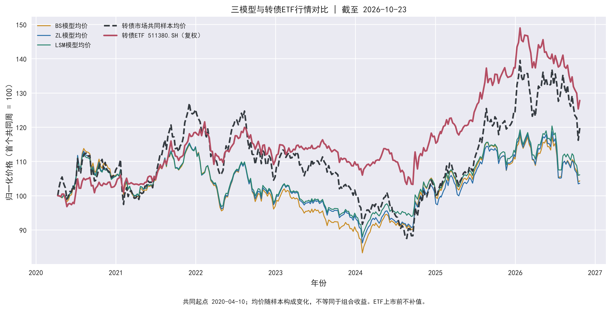

# 中国市场可转债定价模型研究 | Convertible Bond Pricing Research (China Market)

<p align="center">
  <a href="#简体中文"></a>
  &nbsp;
  <a href="#english-version"></a>
</p>

<p align="center">
  
  
  
  
</p>

---

<a id="简体中文"></a>

## 简体中文

**当前语言：中文 | [Switch to English](#english-version)**

👉 快速阅读：[策略净值曲线](#周度均价策略净值曲线) · [研究摘要](summary/key_findings.md) · [报告版本索引](report/README.md)

---

## 项目概述

常规周更新采用[周度均价安全边际策略](long-short%20strategy/WEEKLY_VALUE_STRATEGY.md)：单边5bp综合成本、扣费后2%买入门槛、每只最多10%；只有3只合格就配置30%。使用每日行情和持仓账本，周度选券、下一交易日开盘复核买入上限，同时输出多头和理论多空。旧相对排名与六因子月度结果保留并标明版本。

本项目研究一个具体问题。可转债的市场价格偏离理论价值时，这种偏离究竟是模型遗漏、条款影响，还是可以转化为投资信号的信息？为回答这个问题，项目在统一样本上比较 **Black-Scholes（BS）**、**郑-林（ZL）** 与 **最小二乘蒙特卡罗（LSM）**，并分别开展六因子月度研究与周度安全边际策略。后者直接读取已保存模型均价和基本面，不调用错误定价因子脚本。

项目完整呈现了从研究假设到可复现证据的过程。数据更新、周度定价、因子构建、交易成本和结果发布均由同一套管道管理。定价误差与策略收益分别检验，避免把“拟合更准”直接等同于“投资表现更好”。

### 招生官可以快速核验的证据

| 研究能力 | 仓库中的可核验证据 |
| --- | --- |
| 模型理解 | 从闭式 BS 扩展到含条款路径的 ZL，再到继续价值回归的 LSM |
| 实证判断 | 同时比较价格误差、风险调整收益和最大回撤，不用单一指标下结论 |
| 研究工程 | 建立数据、定价、因子、回测和发布的端到端流程 |
| 可复现性 | 固定随机种子、记录输入指纹与输出哈希，日常只运行新增交易周 |

---

## 论文来源

- 主要参考论文：《中国可转债定价模型比较研究》（郑振龙、兰添晟、陈蓉）。
- LSM 方法参考：[东北证券《可转债研究框架：从理论概念到实战策略》](report/Northeast_Securities_Convertible_Bond_Research_Framework_Theory_to_Strategy_20240823.pdf)。
- CCB、CCBA 与 LSM 券商研报：[English reference index and next-model assessment](report/README.md#broker-research-references)。
- DOI：[10.13821/j.cnki.ceq.2025.01.11](https://doi.org/10.13821/j.cnki.ceq.2025.01.11)。
- 核心思路：同时从定价误差与多空组合 Alpha 两个维度比较多种可转债定价模型。
- 本仓库在 [`report/`](report/) 提供完整报告，便于核对模型假设、参数设定与实证细节。

---

## 仓库框架

本仓库按研究流程组织，从模型定价到因子构建，再到组合回测。

```text
Convertible-Bond-Pricing-Research/
├─ .github/workflows/       #  远端严格增量周更新与研究产物发布
├─ backtest/                #  BS、ZL 与 LSM 定价回测主程序 + 数据管道
│   ├─ data_pipeline.py     #  Tushare 数据管道；日常按 Manifest 边界增量运行
│   ├─ B-S_backtest.py      #  Black-Scholes 周度定价
│   ├─ Z-L_backtest_GPU_prod.py # 条款 Monte Carlo 定价（经验证 CPU 后端）
│   ├─ Z-L_backtest_CPU_prod.py # GitHub Actions CPU 增量入口
│   ├─ LSM_backtest.py      #  LSM 向量化定价与独立增量 Manifest
│   └─ full_history_rebuild.py  # 显式、缓存输入的定价历史重建
├─ mispricing factor/       #  错误定价因子与相关性分析
├─ long-short strategy/     #  横截面多空策略与绩效输出
├─ summary/                 #  面试优先阅读精简总结
├─ report/                  #  完整研究报告（PDF）
├─ AGENTS.md                #  代码导航、数据契约与运行约束
└─ README.md                #  项目总览与方法框架
```

建议阅读顺序：

1. [`summary/key_findings.md`](summary/key_findings.md)
2. [`README.md`](README.md)
3. [`report/CB_pricing_full.pdf`](report/CB_pricing_full.pdf)

---

## 研究动机

中国可转债兼具债券现金流、股票期权和发行条款。转股溢价率等相对指标易受市场整体估值与拥挤交易影响，也难以单独识别赎回、回售和下修条款的价值。绝对定价模型提供了一个可比较的理论锚，但模型复杂度本身不保证更好的投资结果。本研究因此同时检验定价拟合与组合表现。

---

## 定价框架

### 可转债价值拆解

$$
V_{CB} = V_{bond} + V_{option}
$$

- 债券部分：未来现金流贴现。
- 期权部分：嵌入的转股期权。

---

> **定价 v2 已完成（2026-10-28）**：BS、ZL、LSM 已采用统一现金流与条款终止规则完成400周历史重建，并通过输入、文件及财务边界验证。LSM 独立定价，不读取 ZL 价格。下文标注 2026-08-28 的表格及现有策略曲线属于旧版证据；周报、IC 和冻结账本本轮不重算。新方法与独立运行命令见 [PRICING_METHODS.md](backtest/PRICING_METHODS.md)。

<!-- pricing-metrics-zh:start -->
## 最新定价结果与图解（2026-10-23）

三个模型使用相同的 **151,991 个有效券日**，覆盖 **2019-01-04 至 2026-10-23、400 个观察周**。MSE单位为元²；RMSE、MAE和平均偏差为元；MAPE为绝对百分比偏差。平均偏差为理论价减市场价，R²相对于市场报价均值计算。最低单周共同覆盖率 **97.35%**，最新周 **312/313** 只。指标衡量模型与市场报价的偏离。

| 模型 | 样本数 | MSE | RMSE | MAE | MAPE | 平均偏差 | R² |
|---|---:|---:|---:|---:|---:|---:|---:|
| BS | 151,991 | 975.31 | 31.23 | 13.58 | 9.28% | +1.45 | 0.816 |
| ZL | 151,991 | 999.37 | 31.61 | 12.36 | 7.92% | -9.38 | 0.812 |
| LSM | 151,991 | 970.92 | 31.16 | 11.31 | 7.14% | -6.80 | 0.817 |
<!-- pricing-metrics-zh:end -->

[指标原始表](backtest/Pricing_Metrics.csv) · [完整验证记录](backtest/Pricing_Validation.json) · [定价方法与假设](backtest/PRICING_METHODS.md)

### 价格走势：加入可交易的转债 ETF 参照



ETF 采用 **511380.SH 博时可转债 ETF**，使用 Tushare 日线收盘价乘同日复权因子；仅在实际上市后与模型周度日期精确匹配，不补造上市前走势。所有曲线从首个共同观察周归一化为100；转债截面均价会随样本构成变化，不等同于投资组合收益。[行情与因子缓存](backtest/ETF_511380_Daily.csv) · [来源与校验](backtest/ETF_511380_Manifest.json)

### 偏差分布与年度变化


零线表示理论价与市场价一致。箱体展示25–75分位，须线展示5–95分位；所有共同有效样本参与统计。


按年份查看偏差方向与幅度，避免一个全样本均值掩盖市场阶段差异。

### 数据覆盖与抽样不确定性


图中标准误为跨券中位数和95分位，不包含回归策略不确定性、行权网格偏差与模型假设误差。缺失或不一致数据保留原因，不填造定价。

## 模型设计

### 🔹 Black-Scholes Model (BS)

定价逻辑：

$$
V_{option} = S e^{-qT} N(d_1) - X e^{-rT} N(d_2)
$$

- 在股价对数正态假设下的解析解模型。
- 未显式考虑路径依赖条款。

核心特征：

- 对正股价格与波动率高度敏感。
- 无赎回约束时，上行空间不受限。

→ 属于**进攻型定价锚**。

---

### 🔹 Zheng-Lin Model (ZL)

定价逻辑：

按明确条款停止政策进行蒙特卡洛模拟；不宣称精确求解发行人与持有人的博弈。

1. 模拟正股价格路径。
2. 根据真实条款与历史计数评估赎回/回售；不编造未来下修。
3. 逐期支付存续票息，终止时区分现金与转股支付并采用相应信用折现。

模型政策及边界：

- 使用真实滚动触发计数、转股期、合同票息与到期赎回额。
- 发行人按触发条件赎回、通知期为 30 个模拟交易观察日，是明确的模型假设。
- 当前不假设未核验的不赎回承诺和未来下修；相应数据缺口单列披露。

→ 属于**防守型定价锚**。

---

### 🔹 Least-Squares Monte Carlo Model (LSM)

定价逻辑：

1. 以转换价值为状态变量模拟风险中性路径。
2. 从到期日向前回溯，对实值路径的继续持有价值回归于 $1,S,S^2$。
3. 比较即时转股价值与估计的继续价值，得到自愿提前转股价值。
4. 在同一条款路径内决定转股或回售；强赎与到期终止后不再保留未来期权价值。最终价格不使用 ZL 估值下限。

生产参数为 8,192 条训练路径及另 8,192 条独立估值路径，均使用对偶抽样；192 个基础行权区间额外加入转股和付息边界。回归包含平价及条款状态。独立 Manifest 核验历史输入、参数与全部输出完整性；仅处理其自身截止日之后的新交易周。

---

### 模型误差对比

| Error Metric           | BS     | ZL     | LSM    |
| ---------------------- | ------ | ------ | ------ |
| Mean Error (Bias, CNY) | 2.50   | -12.85 | -2.32  |
| MAE (CNY)              | 14.09  | 14.48  | 13.86  |
| RMSE (CNY)             | 31.14  | 33.70  | 32.48  |
| MAPE                   | 9.76%  | 9.49%  | 9.23%  |
| SMAPE                  | 9.69%  | 10.39% | 9.46%  |

MAE/MAPE/SMAPE 越低，模型定价拟合效果越好。

> **口径与时点**：理论价与市场价按相同「交易日 × 转债」单元严格对齐（BS n=149,694；ZL/LSM n=138,820），MAPE 排除市场价为零的单元。周度样本更新至 **2026-08-28**。该旧版样本曾由 CUDA 生产入口计算；当前修正版保留 CPU 对照，并为复杂模型提供经校验的 CUDA 后端；ZL 与 LSM 分别使用独立 Manifest，常规更新只处理各自已验证截止日之后的新交易周。

---

## 数据基础设施

### 自动化数据管道

`backtest/data_pipeline.py` 通过 **Tushare Pro API** 替代了原有的手动 Excel 维护流程，支持全量历史拉取与每日增量更新。

| 数据字段 | Tushare 接口 |
|----------|-------------|
| 可转债收盘价 | `pro.cb_daily(fields='close')` |
| 转换价值 | `pro.cb_daily(fields='convert_val')` |
| 可转债涨跌幅 | 优先使用源字段；缺失时按相邻收盘价手动计算，并以免费行情源校正 |
| 剩余期限 | `pro.cb_basic()` 到期日推算 |
| 正股总市值 | `pro.daily_basic(fields='total_mv')` |
| 信用评级 | `pro.rating(bond_type='CB')` |
| 每股净资产 | `pro.fina_indicator(fields='bps')` |
| 无风险利率 | Akshare 国债收益率曲线 |
| 纯债价值 | Tushare `cb_daily.bond_value`；以合同现金流校准现金信用利差 |

所有输出以宽表 CSV 缓存（行=日期，列=转债代码）。常规周更新从三模型 Manifest 中最新的已验证截止日确定输入刷新边界，各模型分别验证自己的历史，只定价自身截止日后的新增或已缓存交易周。全历史重建仅用于显式维护，不属于日常更新路径。

远端周度更新计划：

| 环节 | 计划与门控 |
|------|------------|
| 定时触发 | GitHub Actions 每周五 17:30（北京时间）运行，也支持手动触发 |
| 交易日口径 | 仅发布该 `W-FRI` 周内最后一个真实交易日；周五休市时自动保留此前最近交易日 |
| 数据门控 | `TUSHARE_TOKEN`、真实源覆盖率、BS 覆盖率与基准日期任一不满足即停止 |
| 执行链路 | GitHub 增量更新真实数据与 BS → CPU 增量更新 ZL → 向量化增量更新 LSM → 更新基准；因子、周报及策略迁移暂缓 |
| 发布边界 | 只在验证通过后提交产物；并发运行不互相取消，失败时保留上一版结果 |

> GitHub 的定时工作流只从默认分支生效。启用前需在仓库 Secrets 中配置 `TUSHARE_TOKEN`。周度 ZL 使用 CPU 增量后端，不依赖本地电脑或 CUDA；修正版全历史重建使用经验证的 CPU/CUDA 引擎与已有真实缓存。
>
> 本地目录无法在电脑关机时被物理写入。运行一次 `backtest/setup_main_sync_task.ps1` 后，电脑登录及在线期间会定期获取远端更新；仅当本地处于干净的 `main` 时才执行 fast-forward，避免覆盖未提交工作。

本地连接排查：本机 Clash 全局代理曾导致 Tushare 返回 HTTP 502、HTTPS 握手失败，切换规则模式后恢复。遇到类似情况，先检查代理路由和 HTTP 状态；SDK 可能把 HTTP 错误转为空表，不能据此判断为非交易日。BS 波动率请求间隔为 0.5 秒，以避开每分钟 200 次的接口限额。

---

## 错误定价因子

$$
Mispricing = V_{model} - V_{market}
$$

- 正值表示模型估值高于市价，负值表示低于市价。
- 估值差不直接等于交易指令；新策略还要求风险准入和扣费后2%买入余量。

---

## 策略构建

### 周度均价安全边际策略

V=(BS+ZL+LSM)/3，S=V/P−1。风险筛选后按S降序、代码升序，最多使用前20%的席位；多头还要求 V×0.9995÷(P×1.0005)−1≥2%，空余席位留现金。单券目标上限10%，不为凑仓买负价差或薄价差券。

采用评级≥AA、价格≤150元、纯债溢价≤40%、期限≥半年、余额≥3亿元、上市超过30天以及20日成交额与财务准入。财报按公告时点生效，完整跟踪要求事件风险已知。模型分歧展示但不改变等权。

下个交易日用有效开盘报价复核冻结的买入上限；每日计价、计费及检查风险。理论空头取合格池末20%，总目标金额匹配多头，披露实际敞口和券源限制。正常成本5bp/边，压力情景10/20bp。

策略入口：`python "long-short strategy/weekly_value_strategy.py" --start 2019-01-01`。结果目录 `long-short strategy/weekly_value_results`。这条命令不运行定价或错误定价因子。

### 历史策略版本

六因子月度研究与旧周度相对排名策略属于其他方法。相对排名前20%仅表示更便宜，不能都称为绝对低估；旧结果不覆盖，也不能套用到新策略。

### 研究假设

策略检验市场价格是否会向理论价值收敛。若偏离只是模型误差或不可交易的条款风险，回测结果不应被解释为稳定 Alpha。

---

## 历史六因子月度结果（2026-08-28版本）

| Strategy | Annualized Excess Return | Sharpe | Max Drawdown |
| -------- | ------------- | ------ | ------------ |
| BS Long  | 12.25%        | 0.91   | -28.96%      |
| ZL Long  | 13.40%        | 0.94   | -29.75%      |
| LSM Long | 13.30%        | 0.92   | -31.04%      |

> **回测口径**：2019-01-25 至 2026-08-28，共 91 个收益观察期，月末调仓，展示扣除交易成本后的多因子等权多头组合；夏普比率使用同期观测的一年期国债收益率均值。同期中证转债基准年化收益为 7.08%。

结论摘要：LSM 将全样本平均定价偏差从 ZL 的 -12.85 元收窄至 -2.32 元，MAPE 也降至 9.23%。但三种多因子组合的年化超额收益接近，LSM 未在策略端稳定超越 ZL，最大回撤也更高。模型拟合与投资价值需要分别检验，这是本项目最重要的实证结论。

---

## 因子相关性与预测检验

以下属于2026-08-28版六因子研究；周度均价策略不改变该研究口径。

因子间冗余使用 Pearson 线性相关和 Spearman 秩相关共同检查。所有因子先统一方向，数值越高代表预期收益越高。定价偏差与流动性、动量和量价因子的相关性较弱，但与估值因子存在清晰重合。BS、ZL 与 LSM 定价偏差对估值因子的 Pearson 相关分别为 0.558、0.535 和 0.465，Spearman 相关分别为 0.612、0.683 和 0.571。因此，定价偏差信号提供了额外信息，但不能被描述为与传统估值正交。

预测检验使用月末可得因子和下一持有期个券收益。每个模型的六个因子共享同一筛选后截面，共覆盖 91 个持有期。IC 为 Pearson 截面相关，Rank IC 为 Spearman 截面相关，ICIR 均按月度均值除以月度标准差计算，未年化。

| 模型 | 因子 | IC | Rank IC | ICIR | Rank ICIR | IC 为正比例 |
| --- | --- | --- | --- | --- | --- | --- |
| BS | 流动性 | -0.021 | -0.070 | -0.10 | -0.39 | 46.2% |
| BS | 波动率 | -0.016 | -0.069 | -0.06 | -0.26 | 45.1% |
| BS | 量价 | -0.003 | -0.058 | -0.02 | -0.37 | 47.3% |
| BS | 估值 | 0.047 | 0.057 | 0.24 | 0.33 | 61.5% |
| BS | 动量 | 0.017 | -0.010 | 0.09 | -0.06 | 59.3% |
| BS | 定价偏差 | 0.077 | 0.044 | 0.48 | 0.27 | 65.9% |
| ZL | 流动性 | -0.018 | -0.071 | -0.08 | -0.36 | 47.3% |
| ZL | 波动率 | -0.019 | -0.071 | -0.07 | -0.28 | 49.5% |
| ZL | 量价 | -0.005 | -0.058 | -0.03 | -0.35 | 45.1% |
| ZL | 估值 | 0.049 | 0.059 | 0.25 | 0.34 | 64.8% |
| ZL | 动量 | 0.017 | -0.012 | 0.08 | -0.08 | 58.2% |
| ZL | 定价偏差 | 0.096 | 0.081 | 0.50 | 0.51 | 72.5% |
| LSM | 流动性 | -0.018 | -0.071 | -0.08 | -0.36 | 47.3% |
| LSM | 波动率 | -0.019 | -0.071 | -0.07 | -0.28 | 49.5% |
| LSM | 量价 | -0.005 | -0.058 | -0.03 | -0.35 | 45.1% |
| LSM | 估值 | 0.049 | 0.059 | 0.25 | 0.34 | 64.8% |
| LSM | 动量 | 0.017 | -0.012 | 0.08 | -0.08 | 58.2% |
| LSM | 定价偏差 | 0.076 | 0.051 | 0.50 | 0.34 | 65.9% |

ZL 定价偏差的平均 IC 和 Rank IC 最高，分别为 0.096 和 0.081，两个正值比例分别为 72.5% 和 70.3%。BS 与 LSM 定价偏差也保持正 IC，但秩相关较弱。流动性、波动率和量价因子的平均 Rank IC 为负，说明预设方向在当前样本中缺乏稳定支持。这一结果与定价偏差单因子优于机械六因子等权组合的回测表现一致。

逐期明细与完整统计见 [BS](mispricing%20factor/BS_factor_ic_history.csv)、[ZL](mispricing%20factor/ZL_factor_ic_history.csv)、[LSM](mispricing%20factor/LSM_factor_ic_history.csv) IC 历史，以及对应的 [BS 汇总](mispricing%20factor/BS_factor_ic_summary.csv)、[ZL 汇总](mispricing%20factor/ZL_factor_ic_summary.csv) 和 [LSM 汇总](mispricing%20factor/LSM_factor_ic_summary.csv)。


---

## 关键图表

### 周度均价策略净值曲线


周度选券、下一交易日开盘成交，按每日行情核算净值，单边综合成本5bp。策略与本图已纳入常规周更新流程，使用固定结果路径展示最新曲线。

周度定价、日频行情和研究策略账本均截至2026-10-23。当前区间为2019-01-07至2026-10-23。多头年化研究收益15.80%、夏普1.11、最大回撤-15.91%；理论多空分别为12.27%、1.16、-11.75%。历史财务与事件覆盖、现金流核验仍不完整，曲线为研究估计；多空未验证历史券源。2026-09-12 归档的成本对照与年度分解见[回测明细](summary/weekly_value_strategy_20260912.md)。 冻结跟踪账本同样截至2026-10-23；本次风险快照于2026-10-27取得，最新事前有效信号仍为2026-10-16。

### 定价误差与市场价格时序（BS / ZL / LSM）


### 多空策略表现（BS / ZL / LSM）


### 因子 Pearson 与 Spearman 相关性（BS / ZL / LSM）


---

## 研究判断

BS、ZL 与 LSM 提供了不同的估值视角。BS 对权益价格和波动率更敏感，ZL 更重视条款约束和债券现金流，LSM 补充自愿提前转股与继续持有决策。三种定价偏差都与估值因子部分重合，其中 ZL 的预测稳定性最高。相关性和 IC 共同表明，模型定价含有额外信息，也暴露了机械等权合成会被方向不稳定的传统因子稀释的问题。

---

## 局限性

- BS 对条款约束刻画不足。
- ZL 计算成本较高。
- LSM 受路径数、行权网格与回归基函数设定影响，当前采用独立路径策略估值；发行人行为、股息与未来下修仍有明确的模型假设，数值收敛需单独检验。
- 空头端在强动量市场中可能承压。

---

## 后续研究

下一步最有价值的工作是把发行人条款行为纳入同一联合路径模型，并开展滚动样本外检验。动态参数校准和交易容量分析也需要在增加模型复杂度前完成。

---

## 完整报告

完整研报见：[report/CB_pricing_full.pdf](report/CB_pricing_full.pdf)

---

## 项目贡献

本仓库交付了一套可审计的三模型比较研究。它把理论定价转化为可检验的横截面信号，也保留了数据边界、模型假设、交易成本和失败条件。实证证据表明，定价精度、策略收益与风险之间并非单调关系，模型复杂度也不能直接证明投资价值。

---

## 引用说明

如使用本项目框架或部分研究成果，请引用本仓库并明确说明模型假设与数据边界。

---

<a id="english-version"></a>

## English Version

**Current Language: English | [切换到中文](#简体中文)**

👉 Read first: [Strategy NAV](#weekly-value-strategy-nav) · [Research Brief](summary/key_findings.md) · [Report Versions](report/README.md)

---

## Overview

The routinely updated [weekly value strategy](long-short%20strategy/WEEKLY_VALUE_STRATEGY.md) uses equal BS/ZL/LSM valuation, 5bp one-way total friction and a 2% valuation margin after round-trip costs. Each long target is capped at 10%; three qualifying bonds imply 30% exposure and approximately 70% cash. Daily accounting and next-session open execution are separate from weekly selection.

This project asks a focused question. When a convertible bond trades away from theoretical value, does the gap reflect model omission, contractual clauses, or information that can support an investment signal? The study compares **Black-Scholes (BS)**, **Zheng-Lin (ZL)**, and **Least-Squares Monte Carlo (LSM)** on one sample, then evaluates a historical six-factor monthly study and a weekly value strategy. The latter reads saved model prices and fundamentals without executing mispricing-factor scripts.

The work documents the full path from a research hypothesis to reproducible evidence. One pipeline manages data updates, weekly valuation, factor construction, transaction costs, and publication. Pricing fit and strategy performance are evaluated separately, so a more accurate model is not assumed to be a better investment model.

### Evidence an admissions reader can verify quickly

| Capability | Evidence in this repository |
| --- | --- |
| Model reasoning | Progression from closed-form BS to clause-aware ZL and continuation-regression LSM |
| Empirical judgment | Joint evaluation of pricing error, risk-adjusted return, and drawdown |
| Research engineering | End-to-end data, pricing, factor, backtest, and publication pipeline |
| Reproducibility | Deterministic seeds, input fingerprints, output hashes, and incremental-only routine runs |

---

## 📚 Paper Source

- Primary reference paper: Comparative Study on Pricing Models of Chinese Convertible Bonds (Zheng Zhenlong, Lan Tiansheng, Chen Rong).
- LSM method reference: [Northeast Securities, *Convertible Bond Research Framework: From Theory to Strategy*](report/Northeast_Securities_Convertible_Bond_Research_Framework_Theory_to_Strategy_20240823.pdf).
- CCB, CCBA and LSM broker references: [English reference index and next-model assessment](report/README.md#broker-research-references).
- DOI: [10.13821/j.cnki.ceq.2025.01.11](https://doi.org/10.13821/j.cnki.ceq.2025.01.11).
- Core idea: compare multiple convertible-bond pricing models by both pricing error and long-short alpha performance.
- The [`report/`](report/) directory documents assumptions, calibration, and empirical outputs.

---

## 🗂️ Repository Structure

This repository is organized by research workflow from model pricing to factor construction and portfolio backtesting.

```text
Convertible-Bond-Pricing-Research/
├─ .github/workflows/       # Strict incremental weekly data and research-output publication
├─ backtest/                # BS, ZL, and LSM pricing engines + data pipeline
│   ├─ data_pipeline.py     # Tushare pipeline; routine runs are bounded by the manifest cutoff
│   ├─ B-S_backtest.py      # Weekly Black-Scholes pricing
│   ├─ Z-L_backtest_GPU_prod.py # Validated clause-Monte-Carlo CPU entrypoint
│   ├─ Z-L_backtest_CPU_prod.py # GitHub Actions CPU incremental entrypoint
│   ├─ LSM_backtest.py      # Vectorized LSM pricing with its own incremental manifest
│   └─ full_history_rebuild.py  # Explicit cache-only historical repricing
├─ mispricing factor/       # Mispricing factor and correlation analysis
├─ long-short strategy/     # Cross-sectional long-short strategy outputs
├─ summary/                 # Concise summary for interview reading
├─ report/                  # Full research reports (PDF)
├─ AGENTS.md                # Code navigation, data contracts, and run constraints
└─ README.md                # Project overview and methodology
```

Suggested reading order

1. [`summary/key_findings.md`](summary/key_findings.md)
2. [`README.md`](README.md)
3. [`report/CB_pricing_full.pdf`](report/CB_pricing_full.pdf)

---

## Motivation

Chinese convertible bonds combine fixed-income cash flows, equity optionality, and issuer-specific clauses. Relative measures such as conversion premium can move with broad valuation regimes and crowded positioning, while revealing little about the value of call, put, and reset provisions. Absolute pricing supplies a comparable theoretical anchor, but greater model complexity does not guarantee better investment outcomes. The study therefore tests both valuation fit and portfolio performance.

---

## 🧠 Pricing Framework

### 1. Convertible Bond Decomposition

$$
V_{CB} = V_{bond} + V_{option}
$$

- Bond component: discounted cash flows.
- Option component: embedded equity call option.

---

> **Pricing v2 completed (2026-10-28)**: BS, ZL and LSM now have 400 rebuilt weeks under consistent cash-flow and stopping rules, verified against observed inputs, file integrity and financial bounds. LSM no longer reads ZL prices. Dated tables and existing strategy curves retain their v1 vintage; weekly reports, IC and frozen ledgers are not rebuilt in this migration. See [pricing methods](backtest/PRICING_METHODS.md).

<!-- pricing-metrics-en:start -->
## Current pricing results and visual diagnostics (2026-10-23)

All models use the same **151,991 valid bond-date cells over 400 observed weeks, 2019-01-04 through 2026-10-23**. MSE is in yuan²; RMSE, MAE and bias are in yuan. Bias is model minus market price; R² uses the market-price mean as its constant baseline. Minimum weekly common coverage is **97.35%**, with **312/313** bonds in the latest week. These are market-price deviation diagnostics.

| Model | N | MSE | RMSE | MAE | MAPE | Bias | R² |
|---|---:|---:|---:|---:|---:|---:|---:|
| BS | 151,991 | 975.31 | 31.23 | 13.58 | 9.28% | +1.45 | 0.816 |
| ZL | 151,991 | 999.37 | 31.61 | 12.36 | 7.92% | -9.38 | 0.812 |
| LSM | 151,991 | 970.92 | 31.16 | 11.31 | 7.14% | -6.80 | 0.817 |
<!-- pricing-metrics-en:end -->

[Metrics CSV](backtest/Pricing_Metrics.csv) · [Validation evidence](backtest/Pricing_Validation.json) · [Methods and assumptions](backtest/PRICING_METHODS.md)


The ETF reference is **511380.SH, Bosera Convertible Bond ETF**. Observed closes times same-date Tushare adjustment factors are matched to actual pricing dates after listing; pre-listing observations are never invented. Each line starts at 100 on the first common week. Changing-universe mean prices are not portfolio returns. [Observed cache](backtest/ETF_511380_Daily.csv) · [Source manifest](backtest/ETF_511380_Manifest.json)


Boxes show quartiles; whiskers show the 5th–95th percentiles. All common valid cells enter the statistics.


Annual slices expose the direction and magnitude of deviations across market conditions.


Standard-error curves show cross-sectional medians and 95th percentiles; they exclude training-policy uncertainty, exercise-grid bias and model assumptions. Missing or inconsistent inputs retain explicit reasons.

## ⚙️ Model Design

### 🔹 Black-Scholes Model (BS)

Pricing Logic

$$
V_{option} = S e^{-qT} N(d_1) - X e^{-rT} N(d_2)
$$

- Closed-form solution under lognormal stock dynamics.
- Ignores path-dependent clauses.

Key characteristics

- High sensitivity to equity price and volatility.
- No upper bound under call-free assumption.

→ Acts as an **offensive pricing anchor**.

---

### 🔹 Zheng-Lin Model (ZL)

Pricing Logic

Monte Carlo valuation under an explicit clause-stopping policy; no exact issuer/holder game solution is claimed.

1. Simulate stock price paths.
2. Evaluate observed call/put terms and historical counters; do not invent future resets.
3. Pay coupons only while alive and discount cash and share payments separately.

Policy and limitations

- Uses observed rolling trigger counts, conversion dates, contractual coupons and redemption.
- Deterministic issuer exercise and a 30-observation notice period are disclosed assumptions.
- Unverified waiver periods and future conversion-price resets are not invented.

→ Acts as a **defensive anchor**.

---

### 🔹 Least-Squares Monte Carlo Model (LSM)

Pricing logic

1. Simulate risk-neutral paths with conversion value as the state variable.
2. Work backward from maturity and regress continuation value on $1,S,S^2$ for in-the-money paths.
3. Compare immediate conversion with estimated continuation value to price voluntary early conversion.
4. Decide conversion and optional put exercise within the same contractual paths; issuer calls terminate future optionality. No ZL price floor is applied.

Production uses 8,192 antithetic training paths and another 8,192 independent valuation paths, 192 base exercise intervals augmented with conversion/coupon boundaries, and clause-state regression. Its independent manifest verifies inputs, parameters and all published artifacts; routine runs append only later weeks.

---

### Model Error Comparison

| Error Metric           | BS     | ZL     | LSM    |
| ---------------------- | ------ | ------ | ------ |
| Mean Error (Bias, CNY) | 2.50   | -12.85 | -2.32  |
| MAE (CNY)              | 14.09  | 14.48  | 13.86  |
| RMSE (CNY)             | 31.14  | 33.70  | 32.48  |
| MAPE                   | 9.76%  | 9.49%  | 9.23%  |
| SMAPE                  | 9.69%  | 10.39% | 9.46%  |

Lower MAE/MAPE/SMAPE indicates better pricing fit.

> **Scope & vintage**: theoretical and market prices are strictly aligned on identical trading-day × bond cells (BS n=149,694; ZL/LSM n=138,820), with zero-market-price cells excluded from MAPE. Weekly observations run through **2026-08-28**. This archived sample used the retired CUDA entrypoint; corrected pricing retains a CPU reference and a validated CUDA backend for complex models. ZL and LSM use separate manifests, and routine updates process only trading weeks after each verified cutoff.

---

## 🏗️ Data Infrastructure

### Automated Data Pipeline

`backtest/data_pipeline.py` replaces the previous manual Excel workflow with a **Tushare Pro API** pipeline supporting both full historical pulls and daily incremental updates.

| Data Field | Tushare API |
|------------|-------------|
| CB closing price | `pro.cb_daily(fields='close')` |
| Conversion value | `pro.cb_daily(fields='convert_val')` |
| CB price change | Prefer the source field; otherwise calculate from adjacent closes and correct with a free quote source |
| Remaining maturity | Derived from `pro.cb_basic()` maturity date |
| Stock market cap | `pro.daily_basic(fields='total_mv')` |
| Credit rating | `pro.rating(bond_type='CB')` |
| Book value per share | `pro.fina_indicator(fields='bps')` |
| Risk-free yield curve | Akshare treasury rate data |
| Bond floor | Observed Tushare `cb_daily.bond_value`; cash spread calibrated to contractual cash flows |

All outputs are cached as wide-format CSVs (rows = trade date, columns = bond code). Routine input refreshes start after the latest of the three verified model cutoffs. Each model validates its own history and prices only later observed weeks, including already cached weeks when it is catching up. Full-history rebuilds are explicit maintenance operations, not the normal update path.

Remote weekly update plan:

| Stage | Schedule and gate |
|-------|-------------------|
| Trigger | GitHub Actions runs every Friday at 17:30 Asia/Shanghai and remains manually dispatchable |
| Trading-date rule | Publish only the final observed date in each `W-FRI` week; if Friday is closed, retain the most recent open date |
| Data gates | Stop if `TUSHARE_TOKEN`, observed-source coverage, BS coverage, or benchmark freshness fails |
| Execution chain | GitHub incremental real-data + BS update → CPU incremental ZL update → vectorized incremental LSM update → benchmark; factor, weekly-report and strategy migrations remain paused |
| Publication boundary | Commit only validated outputs; do not cancel an active run, and retain the previous release on failure |

> Scheduled GitHub workflows run only from the default branch and require the repository `TUSHARE_TOKEN` secret. Weekly ZL runs incrementally on CPU without a local computer or CUDA; corrected full-history pricing rebuilds use the validated CPU/CUDA engine and existing observed caches.
>
> A powered-off computer cannot receive filesystem writes. Run `backtest/setup_main_sync_task.ps1` once to fetch updates at logon and hourly while online. The sync fast-forwards only a clean local `main`, so uncommitted work is never overwritten.

Local connection troubleshooting: Clash global mode on this machine caused Tushare HTTP 502 responses and HTTPS handshake failures; rule mode restored access. Check proxy routing and HTTP status before interpreting an empty SDK result as a non-trading day. BS volatility requests pause for 0.5 seconds to stay below the endpoint's 200 requests/minute limit.

---

## 📊 Mispricing Signal

$$
Mispricing = V_{model} - V_{market}
$$

- Positive means model value exceeds market price; negative means it is lower.
- A valuation gap is not an automatic trade: the new long strategy also requires risk eligibility and a 2% net valuation margin.

---

## 🚀 Strategy Design

### Weekly value strategy

Average V=(BS+ZL+LSM)/3 and rank S=V/P−1 after fundamental, credit, liquidity and event screening. The highest quintile supplies at most floor(N×20%) long slots. A long additionally requires V×0.9995/[P×1.0005]−1≥2%; unused capital stays cash. Three names produce 30% target exposure.

Freeze valuations at the completed-week signal and recheck the buy limit at the next session open. Account daily and charge 5bp only on actual simulated trades; test 10/20bp separately. The theoretical short portfolio uses the lowest eligible quintile with total target notional matched to the long leg. Actual exposures can drift or remain locked; matched amounts do not imply beta neutrality.

Run `python "long-short strategy/weekly_value_strategy.py" --start 2019-01-01`. Outputs are separate in `long-short strategy/weekly_value_results`. No pricing, mispricing-factor or IC script is invoked.

### Historical strategy versions

The monthly six-factor study and original weekly relative-ranking experiment are retained as distinct methods. A relatively cheap bond is not necessarily below absolute model value. Their performance must not be attributed to the new entry rule.

### Research hypothesis

The strategy tests whether market prices converge toward theoretical value. If the gap mainly reflects model error or non-tradable clause risk, the backtest should not be interpreted as persistent alpha.

---

## Historical monthly six-factor results (2026-08-28 vintage)

| Strategy | Annualized Excess Return | Sharpe | Max Drawdown |
| -------- | ------------- | ------ | ------------ |
| BS Long  | 12.25%        | 0.91   | -28.96%      |
| ZL Long  | 13.40%        | 0.94   | -29.75%      |
| LSM Long | 13.30%        | 0.92   | -31.04%      |

> **Backtest scope**: 2019-01-25 to 2026-08-28, 91 return observations, month-end rebalancing, and net-of-cost equal-weight multi-factor long portfolios. Sharpe ratios use the observed average one-year government-bond yield over the same window. The CSI Convertible Bond Index annualized return is 7.08% over the same period.

Summary: LSM narrows mean full-sample pricing bias from ZL's -12.85 CNY to -2.32 CNY and reduces MAPE to 9.23%. Yet annualized excess returns remain similar across the three multi-factor portfolios. LSM does not consistently beat ZL and records a larger maximum drawdown. The project's central empirical lesson is that pricing fit and investment value must be tested separately.

---

## Factor correlation and predictive tests

This section retains the 2026-08-28 six-factor study. The weekly value strategy does not change these factor definitions.

Factor redundancy is evaluated with both Pearson linear correlation and Spearman rank correlation. All factors are direction-adjusted so that a higher value represents a higher expected return. Mispricing has weak correlation with liquidity, momentum, and price-volume factors, but overlaps materially with valuation. The Pearson correlations between valuation and BS, ZL, and LSM mispricing are 0.558, 0.535, and 0.465. Their Spearman correlations are 0.612, 0.683, and 0.571. Mispricing therefore contributes information beyond a simple valuation measure, but it is not orthogonal to conventional valuation.

The predictive test relates each month-end factor to individual-bond returns over the next holding period. The six factors for each model use the same filtered cross-section across 91 periods. IC is the Pearson cross-sectional correlation, Rank IC is its Spearman counterpart, and both ICIR measures are monthly means divided by monthly standard deviations without annualization.

| Model | Factor | IC | Rank IC | ICIR | Rank ICIR | Positive IC |
| --- | --- | --- | --- | --- | --- | --- |
| BS | Liquidity | -0.021 | -0.070 | -0.10 | -0.39 | 46.2% |
| BS | Volatility | -0.016 | -0.069 | -0.06 | -0.26 | 45.1% |
| BS | Price-volume | -0.003 | -0.058 | -0.02 | -0.37 | 47.3% |
| BS | Valuation | 0.047 | 0.057 | 0.24 | 0.33 | 61.5% |
| BS | Momentum | 0.017 | -0.010 | 0.09 | -0.06 | 59.3% |
| BS | Mispricing | 0.077 | 0.044 | 0.48 | 0.27 | 65.9% |
| ZL | Liquidity | -0.018 | -0.071 | -0.08 | -0.36 | 47.3% |
| ZL | Volatility | -0.019 | -0.071 | -0.07 | -0.28 | 49.5% |
| ZL | Price-volume | -0.005 | -0.058 | -0.03 | -0.35 | 45.1% |
| ZL | Valuation | 0.049 | 0.059 | 0.25 | 0.34 | 64.8% |
| ZL | Momentum | 0.017 | -0.012 | 0.08 | -0.08 | 58.2% |
| ZL | Mispricing | 0.096 | 0.081 | 0.50 | 0.51 | 72.5% |
| LSM | Liquidity | -0.018 | -0.071 | -0.08 | -0.36 | 47.3% |
| LSM | Volatility | -0.019 | -0.071 | -0.07 | -0.28 | 49.5% |
| LSM | Price-volume | -0.005 | -0.058 | -0.03 | -0.35 | 45.1% |
| LSM | Valuation | 0.049 | 0.059 | 0.25 | 0.34 | 64.8% |
| LSM | Momentum | 0.017 | -0.012 | 0.08 | -0.08 | 58.2% |
| LSM | Mispricing | 0.076 | 0.051 | 0.50 | 0.34 | 65.9% |

ZL mispricing has the strongest average IC and Rank IC at 0.096 and 0.081. Its positive IC and Rank IC ratios are 72.5% and 70.3%. BS and LSM mispricing also remain positive, although their rank relationships are weaker. Liquidity, volatility, and price-volume record negative mean Rank IC, so their assumed directions are not stable in this sample. This result is consistent with the pricing-factor portfolios outperforming the mechanical equal-weight six-factor combinations.

Period-level observations are available for [BS](mispricing%20factor/BS_factor_ic_history.csv), [ZL](mispricing%20factor/ZL_factor_ic_history.csv), and [LSM](mispricing%20factor/LSM_factor_ic_history.csv). Full summaries are available for [BS](mispricing%20factor/BS_factor_ic_summary.csv), [ZL](mispricing%20factor/ZL_factor_ic_summary.csv), and [LSM](mispricing%20factor/LSM_factor_ic_summary.csv).


---

## 🖼️ Key Figures

### Weekly value strategy NAV


Weekly selection, next-session open execution and daily valuation, with 5bp total friction per side. The strategy and this chart are part of the routine weekly update, using a stable output path for the latest curves.

Weekly pricing, daily inputs and research strategy accounting are through 2026-10-23. Current period: 2019-01-07 to 2026-10-23. Long-only annualized research return is 15.80%, Sharpe 1.11 and maximum drawdown -15.91%; theoretical long-short figures are 12.27%, 1.16 and -11.75%. Historical financial/event coverage and cashflow verification remain incomplete; these are research estimates, and historical borrow availability is unverified. See the 2026-09-12 archived [backtest details](summary/weekly_value_strategy_20260912.md) for cost scenarios and annual returns. Frozen tracking accounting also reaches 2026-10-23; the risk snapshot was obtained on 2026-10-27, so its latest prospective signal remains 2026-10-16.

### Pricing vs Market Time Series (BS / ZL / LSM)


### Long-Short Strategy Performance (BS / ZL / LSM)


### Factor Pearson and Spearman Correlation (BS / ZL / LSM)


---

## Research interpretation

BS, ZL, and LSM offer different valuation perspectives. BS is more sensitive to equity value and volatility. ZL emphasizes contractual constraints and bond cash flows. LSM adds voluntary early-conversion and continuation decisions. All three mispricing measures overlap partly with valuation, while ZL has the most stable predictive relationship. Correlation and IC jointly show incremental model information and the dilution caused by mechanically combining conventional factors whose directions are unstable in this sample.

---

## 📉 Limitations

- BS ignores detailed clause constraints.
- ZL is computationally expensive.
- LSM depends on path count, exercise grid, and regression basis. The current implementation values an independently trained stopping policy. Issuer behaviour, dividends and future resets retain explicit assumptions and require numerical convergence checks.
- Short leg can underperform during momentum-dominated markets.

---

## Future research

The next priority is a joint path model that represents issuer clause behavior and investor conversion decisions together, followed by rolling out-of-sample evaluation. Dynamic calibration and capacity analysis should precede any further increase in model complexity.

---

## 📎 Full Report

Full research report: [report/CB_pricing_full.pdf](report/CB_pricing_full.pdf)

---

## Contribution

The repository delivers an auditable three-model comparison. It converts theoretical valuation into testable cross-sectional signals while preserving data boundaries, assumptions, transaction costs, and failure conditions. Rather than presenting complexity as automatic progress, the evidence shows that pricing accuracy, portfolio return, and risk do not improve monotonically together.

---

## 📚 Citation

If you use this framework or part of this project, please cite the repository and state model assumptions and data boundaries clearly.
