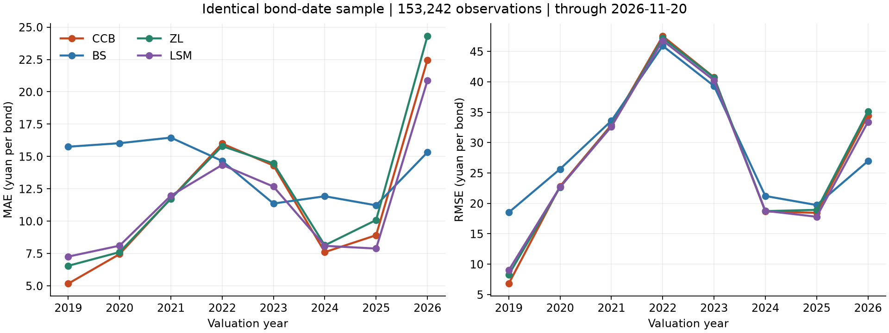

# 基础 CCB 与 BS / ZL / LSM 同样本比较

基础 CCB 的估值区间为 2017-01-06 至 2026-11-20，共 506 个周度截面、157,961 条价格。
四模型共同样本有 153,242 个券日、982 只债券，覆盖 2019-01-04 至 2026-11-20 的 404 个周度截面。
2017 和 2018 年的估值采用[中债国债收益率曲线历史观测](../inputs/chinabond_yields_2017_2018.csv)。共同样本从 BS、ZL、LSM 最早的可用估值日开始。

## 全样本结果

| model | n | MAE | RMSE | MAPE_pct | bias | R2 | median_absolute_error |
| --- | --- | --- | --- | --- | --- | --- | --- |
| CCB | 153242 | 11.8772 | 31.5736 | 7.4757 | -9.0090 | 0.8117 | 6.3304 |
| BS | 153242 | 13.5555 | 31.1778 | 9.2579 | 1.3841 | 0.8164 | 8.5079 |
| ZL | 153242 | 12.4180 | 31.6125 | 7.9634 | -9.4582 | 0.8112 | 7.1464 |
| LSM | 153242 | 11.3467 | 31.1475 | 7.1531 | -6.8610 | 0.8167 | 5.9319 |

MAE、RMSE、bias、绝对误差中位数单位为元/张；MAPE 为百分数；bias=模型价格−市场报价。
同一行券日必须同时有四个正的有限模型价格及市场报价，且已有三模型的市场报价与输入一致。
所有模型采用完全相同的样本、每个券日等权，没有按单个模型另选样本。
上述指标衡量与市场价格的偏离，不能证明谁的真实公允价值更准确。

## 年度 RMSE

| year | n | CCB | BS | ZL | LSM |
| --- | --- | --- | --- | --- | --- |
| 2019 | 8062 | 6.7951 | 18.5104 | 8.2676 | 9.0017 |
| 2020 | 13984 | 22.8106 | 25.6456 | 22.6558 | 22.7068 |
| 2021 | 18857 | 32.9003 | 33.5915 | 32.7159 | 32.6207 |
| 2022 | 20909 | 47.5126 | 45.9121 | 47.2077 | 46.7925 |
| 2023 | 25425 | 40.7402 | 39.3110 | 40.7023 | 40.2459 |
| 2024 | 27057 | 18.6678 | 21.2109 | 18.7254 | 18.7659 |
| 2025 | 24039 | 18.4402 | 19.7238 | 18.9308 | 17.8015 |
| 2026 | 14909 | 34.4575 | 26.9543 | 35.1403 | 33.4001 |

## 模型设定与原研报的关系

- 来源：国盛证券《可转债定价模型与应用》（2023-03-02），第5—9页及第30—31页。
- 保留基础 CCB 的经济假设：保护期内不赎回；之后连续触及赎回线即终止并转股；省略回售和未来下修。
- 保护期为 max(估值日至实际转股开始日的剩余年数, 1/12年)。没有把每只新债统一填成半年。
- 按用户后续要求，主结果**不用固定2%利率**：逐估值日读取国债期限曲线，年有效收益率转为连续利率后按期限插值。
- 使用已观测合同赎回阈值、实际票息和兑付金额。到期兑付已包含末期票息，不重复计算。
- 尊重实际最后转股日；若晚于该日还有现金支付，先将其折现到最后转股日，再作选择。
- 信用风险遵循研报的现金流折减法：到期比较的是信用折减后的现金价值与转股价值。信用利差仅由债底校准，不用转债市场价格倒推。
- 一条债底观测只能识别一个平坦利差；本项目尚无逐券历史信用利率期限结构，未伪造期限利差。政府利率曲线仍完整使用。
- 波动率沿用现有三模型的真实正股历史口径：至多250个复权收盘价、至少60个、年化系数 sqrt(250)，仅允许7个日历日内的已观测值。
- 转股价值过程股息率为0，与现有三模型一致；未声称已纳入逐券未来分红预测。
- **没有历史不赎回公告保护期覆盖层**。这是一月下限的基础情景，不是已验证的发行人真实行为，也不是 CCBA。
- 因使用实际曲线、合同阈值及转股截止日期，本结果是“2023 CCB 经济假设的实际输入扩展”，不是研报固定参数结果的逐项复刻。现有 BS/ZL/LSM 的行权与信用处理也不同。

## 数值验证

- 常利率确定性积分参考，与研报权益/债券现金流分解等价；固定2%只用于这些验证案例。
- 主求解器：对数价格网格上的 Crank–Nicolson PDE，跳跃事件后使用 Rannacher 平滑；网格 dx=0.02，最大步长=0.01041667 年。
- 独立 Brownian-bridge 蒙特卡罗：12 组，每组32,768条路径，标准误按独立反向配对均值计算；最大标准化偏差 1.299。
- 197 个真实券日覆盖各年的平价、波动率、剩余期限及保护期极值与内部点；网格加密后最大变化 0.023715 元。
- 检查记录：[数值核验](numerical_validation.csv)、[真实样本精度检查](observed_grid_convergence.csv)。抽样精度检查不构成所有券日的统一误差上界。

## 补数及剩余缺口

- 2026-10-29 保存的补数审计记录了 122 个基础字段缺失，其中债底 52 个，波动率 70 个。同一券日可能同时缺两项。
- Tushare 缺失债底重新查询后仍未返回；从东方财富历史数据取得并通过同日平价核对的独立债底 16 条，全部有来源记录。
- 这些东方财富值不是同口径 Tushare 债底，只用于补充 CCB 研究覆盖；程序断言四模型共同样本不包含这些来源替换。
- 当轮剩余字段缺失 106 个，其中债底 36 个，波动率 70 个。
- 波动率缺口中 70/70 条对应正股全天停牌，保留缺失。停牌证据来自 [Tushare suspend_d](https://tushare.pro/document/2?doc_id=214)，未用假报价或常数波动率填平。
- 下表统计当前全历史报价样本的排除原因。部分补入债底仍可能不满足现金流一致性检查。

| reason | observations |
| --- | --- |
| observed bond value exceeds the contractual risk-free value | 313 |
| missing or invalid observed inputs: volatility | 185 |
| no remaining contractual cash flows | 58 |
| missing or invalid observed inputs: floor | 40 |
| outside listed lifecycle | 19 |
| contractual cash-flow fields are unavailable | 5 |

合同不完整、生命周期之外、债底超过合同无风险现金流现值等记录不以默认值强行纳入。
源数据及差异：[修复明细](../inputs/repairs.csv)、[不同债底来源的重叠比较](../inputs/alternative_floor_overlap.csv)、[剩余缺失](../inputs/missing_after.csv)、[停牌核查](../inputs/volatility_gap_diagnosis.csv)。

## 可复现文件

- [逐券 CCB 与三模型价格](CCB_observations.csv)
- [四模型共同样本](common_sample.csv)
- [总体指标](comparison_overall.csv)、[年度指标](comparison_by_year.csv)、[按平价分组](comparison_by_parity.csv)
- [周度覆盖率](coverage.csv)、[逐券排除原因](pricing_issues.csv)、[运行记录](manifest.json)
- `../inputs/snapshot/` 保存本次实际使用的周度输入、合同信息、曲线和三模型来源 manifest。
- 运行时 Git HEAD 为 `abb13950912ea49bdfd676597f4d064b1b9fb809`。工作区三模型产物的具体版本记录在快照中的来源 manifest。
